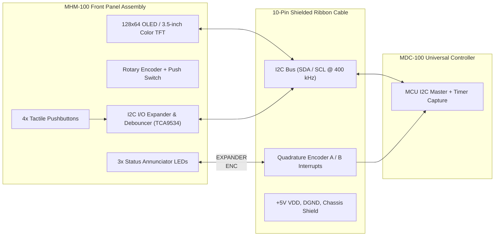

# Module Specification: MHM-100 Human Machine Interface Panel

**Document ID:** MPECL-MOD-MHM-100-001  
**Revision:** v1.0-DRAFT  
**Status:** APPROVED FOR DESIGN  
**Target Organization:** Mendex Electronics LLP  
**Hardware Lead:** Mechanical & UI Hardware Lead  

---

## 1. Purpose and Intended Applications
The **MHM-100 Human Machine Interface Panel** is a modular front-panel operator interface designed to provide real-time visual telemetry, parameter configuration, and manual control for benchtop, rackmount, and cabinet-mounted power conversion equipment.

**Intended Applications:**
- Programmable laboratory DC power supplies and dynamic electronic loads.
- Industrial battery chargers and solar microgrid central monitoring panels.

---

## 2. Functional Requirements
1. **Real-Time Visual Telemetry:** Continuous display of output voltage ($V$), output current ($A$), instantaneous power ($W$), heatsink temperature ($^\circ\text{C}$), and operational status with refresh rate $\ge 10\text{ Hz}$.
2. **Dual-Rate Rotary Input:** Optical or detented mechanical rotary encoder supporting dynamic velocity acceleration for fine and coarse setpoint adjustment.
3. **Tactile Pushbuttons:** Dedicated debounced buttons for `OUTPUT ON/OFF`, `VOLT/CURR SELECT`, `MENU`, and `ENTER/BACK`.
4. **Hardware Status Annunciation:** Discrete high-brightness LED indicators for `CV MODE` (Green), `CC MODE` (Amber), and `TRIP / FAULT` (Red).
5. **Physical Interlock:** Front-panel Emergency Stop button / Master Output Enable directly breaking gate driver power or triggering immediate hardware trip.

---

## 3. Non-Functional Requirements
1. **Viewing Angle & Contrast:** High-contrast sunlight-readable display with viewing angle $\ge 160^\circ$ horizontal and vertical.
2. **Operating Temperature:** $-20^\circ\text{C}$ to $+70^\circ\text{C}$ display operational range.
3. **Front Bezel Ingress Protection:** IP54 compliant when mounted with front-panel silicone gasket.
4. **Lifecycle Endurance:** Rotary encoder rated for $\ge 100,000$ revolutions; pushbuttons rated for $\ge 500,000$ actuations.

---

## 4. Proposed Architecture
MHM-100 consists of a front-panel PCB assembly mounted directly behind the equipment chassis faceplate, interfacing with MDC-100 via a shielded $10\text{-pin}$ ribbon cable. It features an I2C or SPI graphical display, an I2C GPIO expander for buttons/LEDs, and dual hardware quadrature encoder inputs.

---

## 5. Functional Block Diagram

---

## 6. Electrical Interface Requirements
- Supply Voltage: $+5.0\text{ V DC} \pm 5\%$ @ $250\text{ mA}$ maximum.
- On-board low-dropout regulator steps $+5\text{ V}$ down to $+3.3\text{ V}$ for the display controller.
- Logic levels: 3.3 V CMOS compatible, with $10\text{ k}\Omega$ pull-up resistors on all open-drain I2C lines.

---

## 7. Mechanical Interface Considerations
- Dimensions: $120.0\text{ mm} \times 60.0\text{ mm} \times 15.0\text{ mm}$ (standard half-rack 2U / 3U front panel cutout).
- Mounting: 4x M3 threaded brass inserts for rigid chassis screw mounting.
- Rotary knob: Solid aluminum knurled knob with index indicator.

---

## 8. Hardware Component Options
- **OLED Display:** 1.3-inch $128 \times 64$ I2C White OLED (SH1106 controller).
- **TFT Display (Optional High-End):** 3.5-inch $320 \times 480$ SPI IPS TFT (ILI9488 controller).
- **Rotary Encoder:** Bourns PEC11R or Alps EC11 series (24 pulses per revolution, with integrated momentary push switch).
- **I/O Expander:** Texas Instruments TCA9534PWR or NXP PCF8574.
- **Pushbuttons:** Omron B3F series long-travel tactile switches.

---

## 9. Firmware Dependencies
- MCC includes a modular graphics driver: `mpecl_ui_ssd1306.c` or `mpecl_ui_ili9488.c`.
- Non-blocking state machine updates screen contents at $10\text{ Hz}$ in Tier 3 background task without impacting high-speed control loops.

---

## 10. Communication Interfaces
- Hardware bus: I2C ($400\text{ kHz}$) + 2x GPIO lines for encoder quadrature capture.

---

## 11. Safety Requirements
- **Output Enable Safety Dwell:** Activating power output requires pressing the `OUTPUT` button and confirming via LED illumination.
- In the event of ribbon cable disconnection, pull-up resistors on the controller board force the output to safe OFF mode.

---

## 12. Supported Power and Voltage Classes
- Universal: Works with any MPECL power rating where front-panel control is required.

---

## 13. Design Limitations
- OLED displays suffer from long-term burn-in if static text is displayed continuously for $> 50,000\text{ hours}$; firmware implements automatic screen-dimming and pixel-shifting after 5 minutes of operator inactivity.

---

## 14. Reusability Assessment
- **Reuse Rating:** **100% DIRECTLY REUSABLE** for benchtop and rackmount systems; omitted for embedded blind DIN-rail converters.

---

## 15. Simulation Approach
- I2C bus rise times and capacitive loading across ribbon cable ($C_{load} < 100\text{ pF}$) verified in SPICE.

---

## 16. Verification and Acceptance Criteria
1. Display refresh verified jitter-free at $\ge 10\text{ frames/second}$.
2. Rotary encoder velocity acceleration increments setpoint smoothly without dropped pulses.
3. Continuous 100,000 keystroke mechanical actuation test verified with zero contact bounce errors.

---

## 17. Estimated Development Complexity
- **Complexity:** Low-Medium.
- **Key Challenge:** Designing a responsive, intuitive embedded menu navigation system that fits in $< 32\text{ KB}$ Flash memory.

---

## 18. Preliminary BOM Considerations
- Estimated BOM cost: **~\$6.50 - \$9.20 USD** (OLED variant with encoder, buttons, and PCB).

---

## 19. Risks and Dependencies
- **Risk:** OLED glass cracking under mechanical impact during shipping.  
  *Mitigation:* Install a 2 mm protective anti-glare acrylic window in front of the display panel.

---

## 20. Future Scalability
- Future roadmap (MHM-200) targets capacitive touchscreen glass panels with customized GUI running on an embedded Linux / FreeRTOS co-processor.
