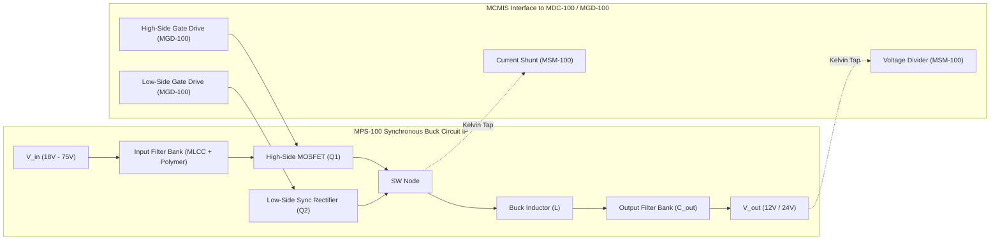

# Module Specification: MPS-100 Synchronous Buck Power Stage

**Document ID:** MPECL-MOD-MPS-100-001  
**Revision:** v1.0-DRAFT  
**Status:** APPROVED FOR DESIGN  
**Target Organization:** Mendex Electronics LLP  
**Hardware Lead:** Power Conversion Hardware Lead  

---

## 1. Purpose and Intended Applications
The **MPS-100 Synchronous Buck Power Stage** is a standardized, high-efficiency step-down DC-DC power conversion design IP block that converts higher DC distribution voltages ($18\text{ V} - 75\text{ V}$, nominal $48\text{ V}$) down to tightly regulated lower DC rails ($12\text{ V}$ or $24\text{ V}$) at continuous power levels from **$100\text{ W}$ to $500\text{ W}$** (scalable to $1\text{ kW}$ via dual-phase interleaving).

**Intended Applications:**
- Tier 1 Priority: Point-of-load DC regulators and telecom 48V-to-12V bus converters.
- Battery pack discharge regulators (48V Li-ion to 12V/24V auxiliary industrial buses).
- Front-end power stage for industrial DIN-rail power systems.

---

## 2. Functional Requirements
1. **Input Voltage Range:** $18\text{ V}$ to $75\text{ V DC}$ continuous (withstand $80\text{ V}$ peak for $100\text{ ms}$).
2. **Output Voltage Options:** Factory configurable for $12.0\text{ V DC} \pm 1\%$ or $24.0\text{ V DC} \pm 1\%$.
3. **Continuous Output Current:** Up to $25\text{ A}$ continuous ($300\text{ W}$ at $12\text{ V}$, $500\text{ W}$ at $24\text{ V}$) with forced-air cooling.
4. **Switching Frequency:** Nominal $100\text{ kHz} - 200\text{ kHz}$ (software configurable via MDC-100).
5. **Bidirectional Current Capability (Configurable):** Capable of operating in forced Continuous Conduction Mode (FCCM) for fast transient response or Diode Emulation Mode (DEM) to prevent reverse current flow into pre-biased loads.

---

## 3. Non-Functional Requirements
1. **Full-Load Efficiency:** $\ge 96.5\%$ at $48\text{ V}$ input, $24\text{ V} / 20\text{ A}$ output ($150\text{ kHz}$).
2. **Output Voltage Ripple:** $\le 50\text{ mV}$ peak-to-peak ($< 0.5\%$) at full load ($20\text{ MHz}$ bandwidth).
3. **Transient Response:** Maximum voltage deviation $\le \pm 3.0\%$ for a $20\% \to 80\%$ load step at $2.5\text{ A/}\mu\text{s}$, settling within $\le 250\,\mu\text{s}$.
4. **Thermal Performance:** Maximum semiconductor case temperature rise $\Delta T \le 40^\circ\text{C}$ above $50^\circ\text{C}$ ambient with $200\text{ LFM}$ forced airflow.

---

## 4. Proposed Architecture
MPS-100 is engineered as a single-phase or interleaved two-phase synchronous buck stage utilizing low-loss Superjunction Silicon MOSFETs ($80\text{ V} - 100\text{ V}$ rating, $R_{DS(on)} < 4\text{ m}\Omega$), high-frequency composite iron powder or Sendust toroidal inductors, and low-ESR hybrid polymer aluminum capacitors.

---

## 5. Functional Block Diagram

---

## 6. Electrical Interface Requirements
- Power terminals: M4 screw terminals or high-current PCB busbar pins rated for $\ge 40\text{ A}$.
- Gate drive input: Direct low-inductance copper pads for MGD-100 gate driver outputs.
- Sensing taps: 4-terminal Kelvin pads for output voltage and inductor current sensing.

---

## 7. Mechanical Interface Considerations
- Physical Format: **Design IP Block (Hierarchical Schematic & Layout Block).**
- Layout Footprint: Laid out on a 4-layer FR4 motherboard ($2\text{ oz}$ outer copper, $2\text{ oz}$ inner power planes). High-current loops kept compact with unbroken ground return directly underneath.

---

## 8. Hardware Component Options
- **High-Side MOSFET:** Infineon BSC035N10NS5 ($100\text{ V}, 3.5\text{ m}\Omega$, Superjunction) or Nexperia PSMN4R2-100YSFX.
- **Low-Side MOSFET:** Infineon BSC026N08NS5 ($80\text{ V}, 2.6\text{ m}\Omega$) or Vishay SiR870ADP.
- **Inductor Core:** Sendust (Kool Mµ) toroid or Wurth WE-HCI high-current flat-wire inductor ($L = 10\,\mu\text{H} - 22\,\mu\text{H}$, rated $I_{sat} \ge 35\text{ A}$).
- **Output Capacitors:** Panasonic OS-CON / Nichicon FPCAP Aluminum Polymer ($470\,\mu\text{F} / 35\text{ V}, ESR < 10\text{ m}\Omega$) paralleled with 10x $10\,\mu\text{F}$ 1210 X7R ceramic capacitors.

---

## 9. Firmware Dependencies
- MDC-100 executes cascaded 2P2Z compensators (inner current loop @ $100\text{ kHz}$, outer voltage loop @ $10\text{ kHz}$).
- Configurable dead-time ($t_{dead} \approx 25\text{ ns} - 40\text{ ns}$).

---

## 10. Communication Interfaces
- Controlled strictly via PWM and analog sensing interfaces defined under MCMIS-120.

---

## 11. Safety Requirements
- **Hardware Trip:** Output overcurrent sensed via MSM-100 trips MSP-100 in $< 750\text{ ns}$, immediately turning off $Q_1$ and $Q_2$.
- **Thermal Sensor:** Dedicated NTC thermistor mounted between the high-side and low-side FETs.

---

## 12. Supported Power and Voltage Classes
- $100\text{ W}$ ($12\text{ V} / 8.3\text{ A}$) to $500\text{ W}$ ($24\text{ V} / 20.8\text{ A}$).

---

## 13. Design Limitations
- Non-isolated: Input ground and output ground are common (PGND). Not suitable for mains-isolated applications without an upstream galvanic stage.

---

## 14. Reusability Assessment
- **Reuse Rating:** **100% DIRECTLY REUSABLE** design IP for 100W–500W step-down products.

---

## 15. Simulation Approach
- Complete switching and conduction loss models simulated in LTspice using manufacturer unencrypted SPICE models.
- Closed-loop Bode plot extracted via Middlebrook AC injection.

---

## 16. Verification and Acceptance Criteria
1. Full-load efficiency measured $\ge 96.0\%$ at nominal $48\text{ V}$ input, $24\text{ V} / 20\text{ A}$ output.
2. Output ripple measured $\le 45\text{ mV}_{pk-pk}$ with coaxial tip-and-barrel probe.
3. Stable phase margin $\ge 55^\circ$ verified across full $10\% - 100\%$ load range.

---

## 17. Estimated Development Complexity
- **Complexity:** Medium.
- **Key Challenge:** Controlling parasitic switch-node ringing ($V_{SW}$) during high-side FET turn-off through optimized RC snubber design ($R_{snub} \approx 2.2\,\Omega, C_{snub} \approx 1\text{ nF}$).

---

## 18. Preliminary BOM Considerations
- Estimated power stage BOM cost: **~\$7.50 - \$11.50 USD** (MOSFETs + High-current inductor + Polymer capacitors + Shunt).

---

## 19. Risks and Dependencies
- **Risk:** High-current inductor saturation during sudden output load steps or short circuits.  
  *Mitigation:* Select sendust/powder cores with soft-saturation characteristics and verify that $I_{sat} \ge 1.4 \times I_{trip}$.

---

## 20. Future Scalability
- Future roadmap (MPS-150) expands to 4-phase interleaved buck for $48\text{ V} \to 1\text{ V}$ high-current server/computing applications ($> 150\text{ A}$).
