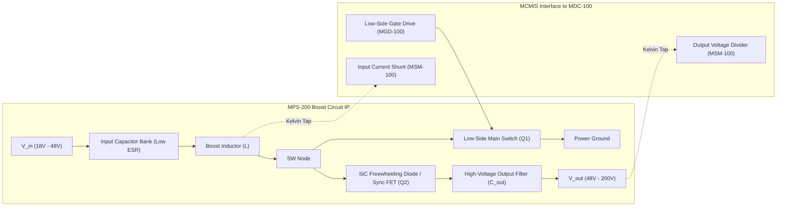

# Module Specification: MPS-200 Boost Power Stage

**Document ID:** MPECL-MOD-MPS-200-001  
**Revision:** v1.0-DRAFT  
**Status:** APPROVED FOR DESIGN  
**Target Organization:** Mendex Electronics LLP  
**Hardware Lead:** Power Conversion Hardware Lead  

---

## 1. Purpose and Intended Applications
The **MPS-200 Boost Power Stage** is a standardized, high-efficiency step-up DC-DC power conversion design IP block that steps up lower DC sources ($18\text{ V} - 48\text{ V}$) to higher DC bus rails ($48\text{ V} - 200\text{ V}$) at power levels from **$100\text{ W}$ to $1\text{ kW}$**.

**Intended Applications:**
- Tier 1 Priority: Solar PV Maximum Power Point Tracking (MPPT) pre-regulator (24V/48V panel to 48V/100V bus).
- Fuel cell voltage boost front-ends.
- Battery discharge booster for industrial motor drives and auxiliary power systems.

---

## 2. Functional Requirements
1. **Input Voltage Range:** $18\text{ V}$ to $48\text{ V DC}$ nominal.
2. **Output Voltage Range:** Configurable from $48\text{ V}$ to $200\text{ V DC}$.
3. **Power Rating:** $250\text{ W}$ (convection cooled) up to $1\text{ kW}$ (forced-air cooled).
4. **Switching Frequency:** $80\text{ kHz} - 150\text{ kHz}$.
5. **Synchronous Rectification Option:** Footprint accommodates either an ultra-fast Silicon Carbide Schottky diode or an active N-Channel MOSFET for synchronous boost rectification.

---

## 3. Non-Functional Requirements
1. **Full-Load Efficiency:** $\ge 97.0\%$ at $48\text{ V}$ input to $100\text{ V}$ output ($500\text{ W}$).
2. **Input Current Ripple:** Continuous Conduction Mode (CCM) with inductor ripple ratio $r = \frac{\Delta I_L}{I_{in}} \le 0.25$ to maximize PV panel MPPT harvesting efficiency.
3. **Dynamic Response:** Stable regulation with Right-Half-Plane (RHP) zero compensation.
4. **Thermal Margin:** $\ge 35^\circ\text{C}$ margin below semiconductor maximum junction temperature at $50^\circ\text{C}$ ambient.

---

## 4. Proposed Architecture
MPS-200 is engineered around low-side Silicon Superjunction MOSFETs (or 650V SiC FETs for high-voltage output variants), a high-saturation Sendust or High-Flux toroid inductor, and an ultra-fast SiC freewheeling diode (zero reverse recovery) to eliminate diode recovery losses.

---

## 5. Functional Block Diagram

---

## 6. Electrical Interface Requirements
- Power terminals: Heavy-duty PCB screw terminals or high-current spade lugs rated for $\ge 30\text{ A}$ continuous input current.
- Gate drive input: Direct Kelvin gate/source copper connection from MGD-100.
- Feedback: Input current sense and output voltage sense routed via shielded differential pairs to MDC-100.

---

## 7. Mechanical Interface Considerations
- Physical Format: **Design IP Block (Hierarchical Schematic & Layout Block).**
- Layout: Low-inductance loop between low-side switch, boost diode, and output capacitor ($< 3\text{ nH}$) to minimize voltage overshoot spikes.

---

## 8. Hardware Component Options
- **Main Switch ($Q_1$):** Infineon IPB036N12N3 ($120\text{ V}, 3.6\text{ m}\Omega$) or Wolfspeed C3M0075120K (1200V SiC for high-voltage variants).
- **Boost Diode ($D_1$):** Wolfspeed C4D05120A (1200V, 5A SiC Schottky diode, $Q_{rr} = 0$) or ON Semi FFSP0665A (650V, 6A).
- **Boost Inductor:** High-Flux or Kool Mµ toroid core (Magnetics Inc / CSC), custom wound with multi-strand Litz wire ($L = 33\,\mu\text{H} - 68\,\mu\text{H}, I_{sat} \ge 30\text{ A}$).
- **Output Capacitors:** Kemet / TDK High-Voltage Film Capacitors paralleled with low-ESR electrolytic capacitors.

---

## 9. Firmware Dependencies
- MCC implements average current-mode control or peak current-mode control with slope compensation.
- Digital MPPT algorithm (Perturb and Observe / Incremental Conductance) executed at $20\text{ Hz}$ in firmware for solar applications.

---

## 10. Communication Interfaces
- Controlled via standard PWM and analog feedback signals defined under MCMIS-120.

---

## 11. Safety Requirements
- **Output Overvoltage Protection:** Boost converters cannot stop energy transfer if $V_{out}$ opens; autonomous hardware OVP shuts off $Q_1$ within $< 500\text{ ns}$ if $V_{out}$ exceeds $110\%$ of rating.
- **Input Disconnect Contactor:** Optional series disconnect FET/relay to interrupt power during catastrophic output short circuits.

---

## 12. Supported Power and Voltage Classes
- $250\text{ W}$ to $1\text{ kW}$ continuous; input up to $48\text{ V}$, output up to $200\text{ V}$.

---

## 13. Design Limitations
- Inherent Right-Half-Plane (RHP) zero limits control loop bandwidth to $\le \frac{1}{4}$ of the RHP zero frequency:
  $$f_c \le \frac{R_{load} \cdot (1 - D)^2}{8 \pi L}$$
- Output short circuit cannot be cleared by turning off $Q_1$; requires input fuse or upstream disconnect.

---

## 14. Reusability Assessment
- **Reuse Rating:** **100% DIRECTLY REUSABLE** design IP for solar MPPT and DC boost converters.

---

## 15. Simulation Approach
- RHP zero trajectory across varying load resistance and duty cycles simulated in LTspice.
- Steady-state thermal balance and inductor core losses calculated using Steinmetz empirical parameters.

---

## 16. Verification and Acceptance Criteria
1. Full-load efficiency measured $\ge 96.8\%$ at $48\text{ V}$ input, $100\text{ V} / 5\text{ A}$ output.
2. Zero diode reverse recovery current spike confirmed on oscilloscope using SiC Schottky diode.
3. MPPT tracking efficiency verified $\ge 99.2\%$ under dynamic solar irradiance sweeps (EN 50530).

---

## 17. Estimated Development Complexity
- **Complexity:** Medium.
- **Key Challenge:** Designing stable compensator poles/zeros that maintain adequate phase margin across wide variations in input voltage and duty cycle ($D = 0.2\text{ to }0.75$).

---

## 18. Preliminary BOM Considerations
- Estimated power stage BOM cost: **~\$9.20 - \$14.50 USD** (Switch + SiC Diode + Inductor + High-V caps).

---

## 19. Risks and Dependencies
- **Risk:** High voltage ringing on switch node due to parasitic diode capacitance.  
  *Mitigation:* Install an RC snubber ($R = 4.7\,\Omega, C = 470\text{ pF}$) across the boost diode.

---

## 20. Future Scalability
- Future roadmap (MPS-250) introduces interleaved multiphase boost for high-power EV fuel cell boost systems ($> 5\text{ kW}$).
