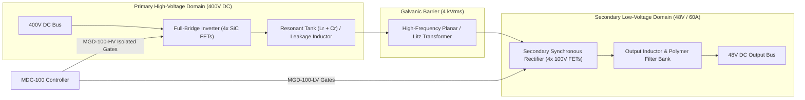

# Module Specification: MPS-300 Isolated High-Power Stage (LLC / PSFB)

**Document ID:** MPECL-MOD-MPS-300-001  
**Revision:** v1.0-DRAFT  
**Status:** APPROVED FOR DESIGN  
**Target Organization:** Mendex Electronics LLP  
**Hardware Lead:** High-Power Systems Lead  

---

## 1. Purpose and Intended Applications
The **MPS-300 Isolated High-Power Stage** is a standardized, high-efficiency galvanic power conversion design IP block engineered for multi-kilowatt applications (**$1\text{ kW}$ to $3\text{ kW}$**, scalable to $10\text{ kW}$). It supports both **LLC Resonant** and **Phase-Shifted Full-Bridge (PSFB)** operation for converting high-voltage DC links ($380\text{ V} - 450\text{ V}$ PFC or battery) to regulated low-voltage, high-current outputs ($24\text{ V} - 48\text{ V DC}$).

**Intended Applications:**
- Industrial EV battery chargers (48 V / 60 A charging profile).
- High-reliability telecommunications and server rectifiers.
- Core isolated conversion engine for 15 kW programmable DC power supplies.

---

## 2. Functional Requirements
1. **Primary DC Link Input:** $380\text{ V}$ to $450\text{ V DC}$ (Nominal $400\text{ V}$ from upstream active PFC stage).
2. **Output Voltage & Current:** Nominal $48.0\text{ V DC}$ (adjustable $36\text{ V} - 58.4\text{ V}$ for Li-ion/Lead-Acid charging) up to $62.5\text{ A}$ continuous ($3.0\text{ kW}$).
3. **Dual Topology Capability:**
   - **Mode A (LLC Resonant):** Variable frequency modulation ($100\text{ kHz} - 250\text{ kHz}$) for fixed-ratio, ultra-high efficiency ($> 97.5\%$).
   - **Mode B (Phase-Shifted Full-Bridge):** Constant frequency phase-shift modulation ($100\text{ kHz}$) for wide-range dynamic voltage and current regulation ($0 - 60\text{ V}$).
4. **Soft-Switching Operation:** Zero-Voltage Switching (ZVS) across all primary switches from $20\%$ to $100\%$ load.
5. **Secondary Synchronous Rectification:** Active secondary MOSFETs or high-current Schottky diodes in center-tapped / full-wave configuration.

---

## 3. Non-Functional Requirements
1. **Peak Electrical Efficiency:** $\ge 97.5\%$ at full load in resonant mode.
2. **Galvanic Isolation Withstand:** Reinforced insulation rated for **$4.0\text{ kV}_{RMS}$ for $60\text{ seconds}$** primary-to-secondary (IEC 62368-1).
3. **Power Density:** $\ge 25\text{ W/in}^3$ forced-air cooled.
4. **Thermal Limit:** Maximum semiconductor heatsink temperature $\le 85^\circ\text{C}$ at $50^\circ\text{C}$ ambient.

---

## 4. Proposed Architecture
MPS-300 consists of a primary full-bridge inverter utilizing four $650\text{ V}$ Silicon Carbide (SiC) MOSFETs or Superjunction FETs, driven by isolated gate drivers (MGD-100-HV). The primary drives a high-frequency planar or Litz-wound transformer (ETD49 or PQ5050 core), with secondary synchronous rectification feeding an LC filter.

---

## 5. Functional Block Diagram

---

## 6. Electrical Interface Requirements
- Primary inputs: Heavy-duty PCB screw terminals or Anderson Powerpole connectors rated for $600\text{ V} / 20\text{ A}$.
- Secondary outputs: Copper busbar blades rated for $\ge 80\text{ A}$ continuous.
- Control interface: High-speed isolated PWM signals and isolated analog feedback lines adhering to MCMIS-120.

---

## 7. Mechanical Interface Considerations
- Physical Format: **Design IP Block / Heavy Motherboard Layout.**
- Motherboard Construction: 6-layer FR4 with $3\text{ oz}$ copper on outer and inner power layers.
- Heatsink: Extruded aluminum tunnel heatsink with forced-air fan shroud.

---

## 8. Hardware Component Options
- **Primary Switches:** Wolfspeed C3M0065090D (900V, 65 mΩ SiC) or STMicroelectronics SCT3030KL (650V SiC) or Infineon IPW65R041CFD (650V CoolMOS).
- **Secondary Rectifiers:** Infineon BSC035N10NS5 ($100\text{ V}, 3.5\text{ m}\Omega$) or Vishay Siliconix VISHAY-100V-TO247.
- **Transformer Core:** TDK ETD49 or Ferroxcube PQ5050 (3C95/N87 ferrite material), primary wound with Litz wire ($0.1\text{ mm} \times 350\text{ strands}$), secondary stamped copper sheet ($0.5\text{ mm}$ thick).
- **Resonant Capacitors:** High-current polypropylene film capacitors (e.g., Kemet R76 or EPCOS B32652).

---

## 9. Firmware Dependencies
- MDC-100 executes variable-frequency resonant control ($100\text{ kHz} - 250\text{ kHz}$) or constant-frequency phase-shift modulation via TI C2000 HRPWM / STM32 HRTIM.
- Dynamic dead-time adjustment algorithm maintaining ZVS across load variations.

---

## 10. Communication Interfaces
- Internal: MCMIS isolated PWM, trip zones, and analog telemetry lines.

---

## 11. Safety Requirements
- **Primary-to-Secondary Creepage:** Minimum **$8.0\text{ mm}$** clearance across transformer bobbin and optical/magnetic isolation barriers.
- **Cycle-by-Cycle Peak Primary Current Trip:** Monitored via high-frequency current transformer (CT) on primary leg, tripping MSP-100 in $< 500\text{ ns}$.

---

## 12. Supported Power and Voltage Classes
- $1\text{ kW}$ to $3\text{ kW}$ per module. Scalable to $15\text{ kW}$ by paralleling modules with active current sharing (MPC-100).

---

## 13. Design Limitations
- LLC resonant topology cannot regulate down to $0\text{ V}$ output; for laboratory power supplies requiring $0 - 60\text{ V}$ full-range control, the stage must be operated in **Phase-Shifted Full-Bridge (PSFB)** mode.

---

## 14. Reusability Assessment
- **Reuse Rating:** **100% DIRECTLY REUSABLE** design IP for all isolated high-power industrial converters.

---

## 15. Simulation Approach
- Resonant tank gain curves ($M(f_n, Q, k)$) and zero-voltage switching transitions simulated in LTspice using detailed SiC switch capacitance models.

---

## 16. Verification and Acceptance Criteria
1. Full-load efficiency measured $\ge 97.2\%$ at $400\text{ V}$ input, $48\text{ V} / 60\text{ A}$ output.
2. Drain-source voltage ringing confirmed zero (clean ZVS transition) on all 4 primary switches at rated load.
3. Reinforced dielectric withstand verified at $4.0\text{ kV}_{RMS}$ for $60\text{ seconds}$.

---

## 17. Estimated Development Complexity
- **Complexity:** High.
- **Key Challenge:** High-frequency planar transformer leakage inductance control and secondary synchronous rectifier gate timing tuning.

---

## 18. Preliminary BOM Considerations
- Estimated power stage BOM cost: **~\$42.00 - \$58.00 USD** (Primary SiC FETs + Secondary FETs + Planar Transformer + Resonant Caps + Heatsink).

---

## 19. Risks and Dependencies
- **Risk:** Transformer overheating due to proximity effect losses in high-current secondary copper sheets.  
  *Mitigation:* Interleave primary and secondary winding layers (P-S-P-S-P) to cancel high-frequency magnetomotive force (MMF).

---

## 20. Future Scalability
- Future roadmap (MPS-350) targets 800V EV battery bus systems utilizing 1200V SiC modules and integrated Dual Active Bridge (DAB) bidirectional power flow.
