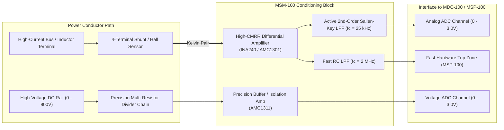

# Module Specification: MSM-100 Voltage & Current Sensing Subsystem

**Document ID:** MPECL-MOD-MSM-100-001  
**Revision:** v1.0-DRAFT  
**Status:** APPROVED FOR DESIGN  
**Target Organization:** Mendex Electronics LLP  
**Hardware Lead:** Mixed-Signal Instrumentation Lead  

---

## 1. Purpose and Intended Applications
The **MSM-100 Voltage and Current Sensing Subsystem** is a precision analog signal-conditioning design IP block responsible for acquiring, filtering, and scaling high-power voltages, currents, and temperatures into standard low-noise differential signals ($0\text{ to }3.0\text{ V}$) for the MDC-100 controller.

**Intended Applications:**
- Input and output DC bus voltage monitoring.
- High-frequency inductor current feedback for inner current regulation loops.
- Overcurrent and short-circuit trip threshold generation for MSP-100.
- AC line voltage and current measurement in power factor correction (PFC) stages.

---

## 2. Functional Requirements
1. **Dynamic Voltage Scaling:** Linearly scale input voltages up to $800\text{ V DC}$ to $0 - 3.000\text{ V DC}$ with gain error $\le \pm 0.5\%$ and temperature drift $< 25\text{ ppm/}^\circ\text{C}$.
2. **High-Speed Current Sensing:** Sense bidirectional currents up to $100\text{ A}$ with a small-signal bandwidth $\ge 500\text{ kHz}$ to support cycle-by-cycle peak current limiting.
3. **Common-Mode Rejection Ratio (CMRR):** Maintain $\ge 80\text{ dB}$ CMRR at $100\text{ kHz}$ to reject severe switching node $dv/dt$ transients.
4. **Dual Output Generation:** Provide simultaneous filtered output for ADC sampling ($f_c = 25\text{ kHz}$) and unfiltered fast output for hardware trip comparators ($f_c \ge 2\text{ MHz}$).
5. **Galvanic Isolation (HV Domain):** Provide reinforced isolation with working voltage $\ge 1000\text{ V DC}$ and CMTI $\ge 100\text{ kV/}\mu\text{s}$.

---

## 3. Non-Functional Requirements
1. **Total Harmonic Distortion (THD):** $< 0.1\%$ across the full dynamic sensing range.
2. **Sensor Insertion Loss:** Shunt dissipation constrained to $\le 1.5\text{ W}$ at rated continuous current.
3. **Phase Delay:** Total phase delay through sensing circuit $\le 5^\circ$ at converter loop crossover frequency ($10\text{ kHz}$).
4. **Operating Temperature:** $-40^\circ\text{C}$ to $+105^\circ\text{C}$.

---

## 4. Proposed Architecture
MSM-100 provides two standardized design implementations:
- **MSM-100-LV (Non-Isolated Low-Voltage):** 4-terminal Manganin metal-strip shunt resistor paired with a high-CMRR dedicated bidirectional current-sense amplifier (e.g., TI INA240).
- **MSM-100-HV (Galvanically Isolated High-Voltage):** Isolated $\Sigma\Delta$ modulator / isolation amplifier (e.g., TI AMC1301/AMC1311) or closed-loop Hall-effect current transducer (e.g., LEM HO-P series).

---

## 5. Functional Block Diagram

---

## 6. Electrical Interface Requirements
- **Power Supply:** $+5.0\text{ V DC} \pm 5\%$ (analog VDD).
- **Output Signal Range:** $0.000\text{ V}$ to $3.000\text{ V DC}$ (linear nominal), clamped at $+3.3\text{ V}$ via low-leakage Schottky diodes to protect MCU inputs.
- **Output Impedance:** $\le 50\,\Omega$ to rapidly charge MCU ADC internal sample-and-hold capacitors ($C_{sh} \approx 5\text{ pF}$).

---

## 7. Mechanical Interface Considerations
- **Physical Format:** **Design IP Block (Hierarchical Schematic & Layout Block).**
- **Kelvin Routing Mandate:** Shunt voltage taps must be routed as a tightly coupled differential pair ($< 0.2\text{ mm}$ spacing) surrounded by analog ground shield traces, connecting strictly to the internal sense pads of the 4-terminal shunt.

---

## 8. Hardware Component Options
- **Current Sense Amp (LV):** Texas Instruments INA240A2 (Gain = 50 V/V, 80 dB CMRR @ 100 kHz) or Analog Devices AD8418.
- **Isolated Current Amp (HV):** TI AMC1301DWV (Reinforced isolated delta-sigma amplifier) or Silicon Labs Si8920.
- **Isolated Voltage Amp (HV):** TI AMC1311DWV (High-input-impedance 2 V input range, 5 kVrms isolation).
- **Hall-Effect Transducer:** LEM HO 25-P/SP33 or Allegro ACS772LCB-050B.
- **Precision Shunts:** Vishay Dale WSLP or Isabellenhütte BVN metal-strip precision shunts ($0.5\text{ m}\Omega - 5\text{ m}\Omega$, 1% tolerance, 50 ppm/°C).

---

## 9. Firmware Dependencies
- Software calibration lookup table and two-point gain/offset correction routine executed in MDC-100 initialization.

---

## 10. Communication Interfaces
- Pure analog differential lines: `I_SENSE_ADC`, `I_SENSE_TRIP`, `V_SENSE_ADC`.

---

## 11. Safety Requirements
- **Overvoltage Clamping:** Dual low-leakage clamping diodes (e.g., BAV99) prevent overvoltage injection into MCU pins during catastrophic output short circuits.
- **Creepage:** Minimum $6.4\text{ mm}$ surface creepage across the isolation amplifier footprint in HV variants.

---

## 12. Supported Power and Voltage Classes
- Scalable from $100\text{ W}$ ($12\text{ V} / 10\text{ A}$) to $15\text{ kW}$ ($800\text{ V} / 100\text{ A}$) by adjusting shunt resistance value and divider ratios.

---

## 13. Design Limitations
- Resistive shunts in high-current paths ($> 50\text{ A}$) generate significant heat; Hall-effect transducers must be substituted despite higher unit cost.
- AMC1301 requires an isolated auxiliary power supply on the high-voltage primary side.

---

## 14. Reusability Assessment
- **Reuse Rating:** **REUSABLE WITH CONFIGURATION (RC)** for LV; **HARDWARE VARIANT (HV)** for HV isolated products.

---

## 15. Simulation Approach
- Common-mode transient rejection ($dv/dt$ coupling) and Sallen-Key low-pass filter phase delay modeled in LTspice using AC frequency response and transient analysis.

---

## 16. Verification and Acceptance Criteria
1. Linearity verified $R^2 \ge 0.999$ across $5\%$ to $100\%$ rated current.
2. Common-mode step of $400\text{ V}$ at $50\text{ V/ns}$ produces $< 50\text{ mV}$ disturbance on differential output.
3. Temperature drift verified $< 0.5\%$ total error from $25^\circ\text{C}$ to $85^\circ\text{C}$.

---

## 17. Estimated Development Complexity
- **Complexity:** Medium.
- **Key Challenge:** Preventing high-frequency noise from switching inductors from coupling into high-gain amplifier inputs.

---

## 18. Preliminary BOM Considerations
- MSM-100-LV BOM cost: **~\$1.20 - \$1.80 USD** (Shunt + INA240 + passives).
- MSM-100-HV BOM cost: **~\$4.50 - \$7.00 USD** (AMC1301 / Hall sensor + isolated bias).

---

## 19. Risks and Dependencies
- **Risk:** DC bias degradation and thermal drift in low-cost commercial shunts.  
  *Mitigation:* Standardize on Manganin / Zeranin alloy shunts with specified $< 50\text{ ppm/}^\circ\text{C}$ temperature coefficient.

---

## 20. Future Scalability
- Future roadmap (MSM-200) evaluates digital telemetry output directly via isolated SPI/Manchester-encoded bitstream, eliminating analog PCB trace routing entirely.
