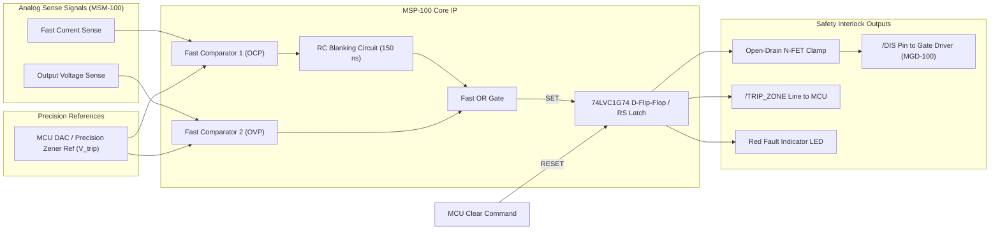

# Module Specification: MSP-100 Smart Protection Subsystem

**Document ID:** MPECL-MOD-MSP-100-001  
**Revision:** v1.0-DRAFT  
**Status:** APPROVED FOR DESIGN  
**Target Organization:** Mendex Electronics LLP  
**Hardware Lead:** Safety & Protection Lead  

---

## 1. Purpose and Intended Applications
The **MSP-100 Smart Protection Subsystem** is an autonomous, hardware-based fault detection and latching design IP block that provides instantaneous protection against short circuits, overcurrent, and overvoltage events completely independent of microcontroller firmware execution.

**Intended Applications:**
- Primary hardware defense line for all MPECL power converters (100 W to 15 kW).
- Direct gate driver hardware shutdown and MCU trip zone assertion.

---

## 2. Functional Requirements
1. **Sub-Microsecond Latency:** Trigger hardware trip line within **$< 750\text{ ns}$** from fault threshold violation to gate pull-down.
2. **Window Comparator Detection:** Simultaneously detect overvoltage (OVP), undervoltage (UVP), and overcurrent (OCP) using precision window comparators.
3. **Leading-Edge Blanking (LEB):** Suppress transient diode recovery and capacitive turn-on spikes ($150\text{ ns} - 200\text{ ns}$) to prevent nuisance tripping.
4. **Hardware Latching:** Lock the `/TRIP_OUT` line low upon fault assertion; must not automatically oscillate or reset upon fault current drop.
5. **Deterministic Reset:** Require an intentional active-high clear pulse from the MCU or physical push button to release the latch after fault clearance.

---

## 3. Non-Functional Requirements
1. **Immunity to Firmware Crash:** The protection path must remain $100\%$ operational even if the microcontroller hangs, resets, or suffers clock oscillator failure.
2. **Trip Reference Accuracy:** Reference threshold accuracy $\le \pm 1.5\%$ across industrial temperature range.
3. **Power Consumption:** Static power draw $\le 75\text{ mW}$.
4. **Operating Temperature:** $-40^\circ\text{C}$ to $+105^\circ\text{C}$.

---

## 4. Proposed Architecture
MSP-100 is implemented using dual ultra-fast analog comparators paired with a dedicated 74LVC-series Set-Reset (RS) flip-flop. The comparator directly asserts the flip-flop `SET` pin. The inverted `Q` output drives an N-channel MOSFET pulling down the gate driver `/DIS` line while routing an active-low interrupt to the MCU `/TRIP_ZONE` pin.

---

## 5. Functional Block Diagram

---

## 6. Electrical Interface Requirements
- **Supply Voltage:** $+3.3\text{ V}$ or $+5.0\text{ V DC} \pm 5\%$ from clean analog rail.
- **Trip Input Voltage:** $0\text{ to }3.0\text{ V}$ analog threshold.
- **Output Signals:** Open-drain active-low `/FAULT_TRIP` capable of sinking $\ge 25\text{ mA}$ to pull down multiple gate driver disable pins simultaneously.

---

## 7. Mechanical Interface Considerations
- **Physical Format:** **Design IP Block (Hierarchical Schematic & Layout Block).**
- **Placement:** Positioned immediately adjacent to the current sense amplifier (MSM-100) and gate driver logic inputs (MGD-100) to keep trip trace lengths $< 25\text{ mm}$.

---

## 8. Hardware Component Options
- **Fast Comparators:** Texas Instruments LMH7220 (2.9 ns propagation delay) or Microchip MCP6561 (56 ns delay, low cost) or integrated MCU CMPSS comparators.
- **Logic Latch:** Nexperia / TI 74LVC1G74 (Single D-type flip-flop configured as RS latch).
- **Mute Clamp FET:** 2N7002 or BSS138 N-channel MOSFET ($R_{DS(on)} < 3\,\Omega$).

---

## 9. Firmware Dependencies
- MDC-100 configures trip threshold DAC during boot.
- MCU firmware executes `TRIP_ZONE_IRQ` service routine to record fault telemetry.
- Firmware asserts GPIO high pulse ($\ge 10\,\mu\text{s}$) on `RESET_LATCH` pin to clear the fault after verifying system health.

---

## 10. Communication Interfaces
- Hardware discrete lines: `/FAULT_TRIP`, `RESET_LATCH`, `TRIP_STATUS`.

---

## 11. Safety Requirements
- **Failsafe Design:** If the $+3.3\text{ V}$ supply drops or fails, a pull-down resistor or supervisor IC automatically holds the gate driver disable line low, preventing uncontrolled switching under brownout.

---

## 12. Supported Power and Voltage Classes
- Universal applicability across all power tiers ($100\text{ W}$ to $15\text{ kW}$).

---

## 13. Design Limitations
- Cannot detect slow thermal accumulation (managed separately by firmware $I^2t$ algorithm).
- Hardwired threshold requires DAC reconfiguration if current limits change dynamically in programmable power supply mode.

---

## 14. Reusability Assessment
- **Reuse Rating:** **100% DIRECTLY REUSABLE** across all converter architectures.

---

## 15. Simulation Approach
- Propagation delays, noise margins, and RC blanking filter step response simulated in LTspice using piecewise linear current injection models.

---

## 16. Verification and Acceptance Criteria
1. Total trip latency from current threshold crossing to gate driver output $0\text{ V}$: **$\le 650\text{ ns}$**.
2. Verification that a $100\text{ ns}$ noise pulse below threshold does not cause latching.
3. Verification that latch maintains locked state across a $5\text{ minute}$ test window until reset pulse arrives.

---

## 17. Estimated Development Complexity
- **Complexity:** Low-Medium.
- **Key Challenge:** Layout shielding to prevent switching noise spikes from triggering false trips without excessively slowing down the blanking filter.

---

## 18. Preliminary BOM Considerations
- Estimated BOM cost: **~\$0.65 - \$1.10 USD** (Comparator + 74LVC latch + clamp FET + passives).

---

## 19. Risks and Dependencies
- **Risk:** High-frequency ground bounce during severe short circuit lifting comparator reference.  
  *Mitigation:* Local star-grounding to AGND plane and high-frequency decoupling capacitor placed directly across comparator power pins.

---

## 20. Future Scalability
- Future roadmap (MSP-200) evaluates integrating programmable digital window trip logic into an ultra-low-power CPLD/FPGA for complex multi-channel parallel converters.
