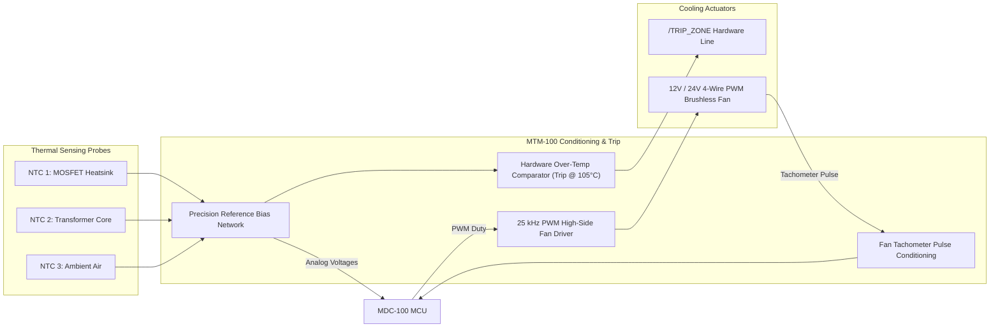

# Module Specification: MTM-100 Thermal Monitoring & Fan Controller

**Document ID:** MPECL-MOD-MTM-100-001  
**Revision:** v1.0-DRAFT  
**Status:** APPROVED FOR DESIGN  
**Target Organization:** Mendex Electronics LLP  
**Hardware Lead:** Thermal & Mechanical Systems Lead  

---

## 1. Purpose and Intended Applications
The **MTM-100 Thermal Monitoring and Fan Controller** is a dedicated thermal management design IP block that monitors heatsink and ambient temperatures, dynamically regulates cooling fan speeds via 4-wire PWM, and executes thermal protection sequences (derating and shutdown) to prevent semiconductor overheating under harsh Indian climatic conditions ($50^\circ\text{C}$ ambient).

**Intended Applications:**
- Forced-air cooled power stages in converters from $500\text{ W}$ to $15\text{ kW}$.
- Enclosure internal temperature regulation and fan failure detection.

---

## 2. Functional Requirements
1. **Multi-Zone Temperature Acquisition:** Read up to 4 independent NTC thermistor channels (Heatsink Primary, Heatsink Secondary, Transformer Core, Intake Ambient Air).
2. **Dynamic 4-Wire Fan PWM Control:** Output a $25\text{ kHz}$ PWM control signal with duty cycle dynamically adjusted based on highest active temperature sensor.
3. **Fan Tachometer Speed Feedback:** Ingest open-collector tachometer pulses from cooling fans to detect locked-rotor or fan failure conditions.
4. **Autonomous Thermal Shutdown:** Hardware thermal trip circuit shuts down gate drivers if heatsink temperature exceeds $105^\circ\text{C}$, even if firmware hangs.
5. **Acoustic Noise Minimization:** Fan speed throttled to minimum required RPM at light load to reduce audible noise in laboratory environments.

---

## 3. Non-Functional Requirements
1. **Fan Speed Control Resolution:** $\ge 8\text{-bit}$ PWM resolution ($0.4\%$ duty cycle steps).
2. **Measurement Accuracy:** $\pm 1.5^\circ\text{C}$ from $25^\circ\text{C}$ to $105^\circ\text{C}$.
3. **Fan Drive Capacity:** Support up to 2x $12\text{ V DC}$ fans drawing up to $1.2\text{ A}$ combined continuous current.
4. **Operating Temperature:** $-40^\circ\text{C}$ to $+105^\circ\text{C}$.

---

## 4. Proposed Architecture
MTM-100 utilizes precision resistor divider bias networks for NTC thermistors, feeding MDC-100 analog inputs. A dedicated high-side or low-side MOSFET switch (e.g., TI TPS1H100 or discrete FET) modulates fan power, and a discrete comparator circuit provides an autonomous hardware thermal trip threshold.

---

## 5. Functional Block Diagram

---

## 6. Electrical Interface Requirements
- Supply Voltage: $+12.0\text{ V DC} \pm 10\%$ (Fan Power) and $+3.3\text{ V DC}$ (Sensor Bias).
- Fan PWM Output: $25\text{ kHz} \pm 1\text{ kHz}$ open-drain or 5V push-pull (conforming to Intel 4-Wire Fan Specification).
- Tachometer Input: Internal $10\text{ k}\Omega$ pull-up to 3.3V, Schmitt-trigger filtered.

---

## 7. Mechanical Interface Considerations
- Physical Format: **Design IP Block** laid out directly on power motherboard near chassis fan exhaust.
- Fan Header: Standard 4-pin polarized Molex KK / locking header.

---

## 8. Hardware Component Options
- **Thermistor:** Murata NTHS series 10 kΩ NTC (B25/85 = 3977 K, 1% tolerance, SMD 0603 or bead probe).
- **Fan Driver FET:** Vishay SI2302 (N-FET) or TI TPS1H100 (Smart High-Side Switch with current sensing).
- **Comparator:** Microchip MCP6561 or integrated MCU analog comparator.

---

## 9. Firmware Dependencies
- Steinhart-Hart equation or 32-point temperature lookup table executed in MCC Tier 3 task ($10\text{ Hz}$).
- Proportional-Integral (PI) fan speed control loop mapping temperature rise to fan duty cycle:
  $$D_{fan}(T) = \begin{cases} 0\% & T < 45^\circ\text{C} \\ \frac{T - 45^\circ}{85^\circ - 45^\circ} \times 100\% & 45^\circ\text{C} \le T \le 85^\circ\text{C} \\ 100\% & T > 85^\circ\text{C} \end{cases}$$

---

## 10. Communication Interfaces
- Analog inputs: `TEMP_CH1` to `TEMP_CH4`.
- Digital discrete: `FAN_PWM`, `FAN_TACH`, `/THERMAL_TRIP`.

---

## 11. Safety Requirements
- **Fan Stall Lockout:** If tachometer feedback detects 0 RPM while fan PWM is commanded $\ge 50\%$ for $> 3\text{ seconds}$, the firmware reduces maximum converter power output by $50\%$ and logs a `FAN_LOCKED_ROTOR` warning.
- **Hardware Latch:** If temperature hits $105^\circ\text{C}$, the hardware comparator latches `/TRIP_ZONE` low, shutting down the converter immediately.

---

## 12. Supported Power and Voltage Classes
- Scalable across all forced-air cooled converters ($500\text{ W}$ to $15\text{ kW}$).

---

## 13. Design Limitations
- Thermistor thermal time constant ($t \approx 1.5 - 3.0\text{ seconds}$) means thermistors detect steady-state heatsink rise, not sub-millisecond semiconductor junction spikes (handled by fast electrical current sensing).

---

## 14. Reusability Assessment
- **Reuse Rating:** **100% DIRECTLY REUSABLE** schematic IP block across all forced-air products.

---

## 15. Simulation Approach
- Thermal transient RC networks (Foster models) simulated in LTspice to verify heatsink time-to-trip under complete fan failure conditions.

---

## 16. Verification and Acceptance Criteria
1. Temperature measurement linearity verified within $\pm 1.0^\circ\text{C}$ against calibrated thermocouple from $25^\circ\text{C}$ to $100^\circ\text{C}$.
2. Fan stall detection correctly triggers fault within $\le 3.5\text{ seconds}$ of physical fan stoppage.
3. Hardware thermal shutdown verifies gate driver mute at $105^\circ\text{C} \pm 2^\circ\text{C}$.

---

## 17. Estimated Development Complexity
- **Complexity:** Low.
- **Key Challenge:** Mechanical placement of thermistors to ensure intimate thermal contact with heatsink base without violating high-voltage isolation clearances.

---

## 18. Preliminary BOM Considerations
- Estimated BOM cost: **~\$0.80 - \$1.40 USD** (Sensors + FET + passives).

---

## 19. Risks and Dependencies
- **Risk:** Dust accumulation on fan blades reducing airflow over time in Indian factory environments.  
  *Mitigation:* Firmware logs total fan operating hours and prompts operator for filter cleaning.

---

## 20. Future Scalability
- Future roadmap (MTM-200) targets multi-zone fan control for 19-inch 3U rack systems with hot-swappable N+1 redundant fan trays.
