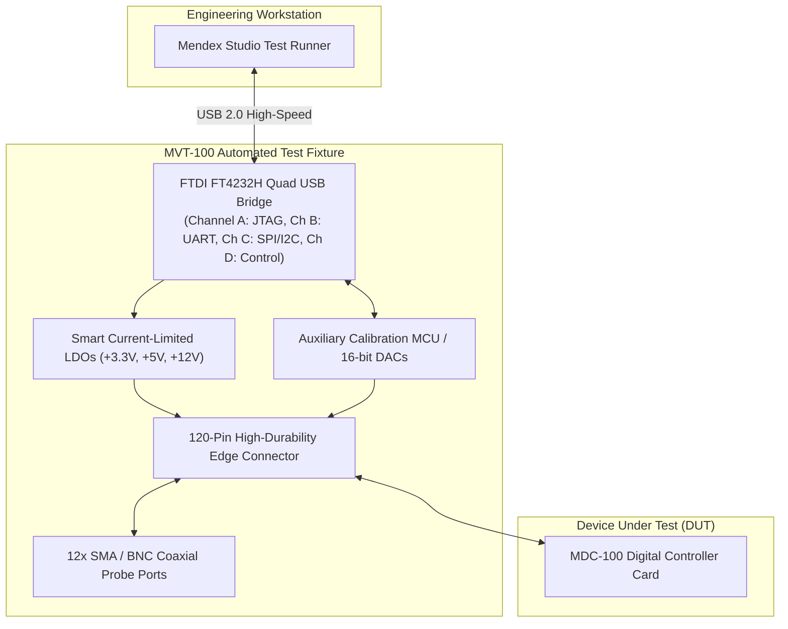

# Module Specification: MVT-100 Validation & Automated Test Harness

**Document ID:** MPECL-MOD-MVT-100-001  
**Revision:** v1.0-DRAFT  
**Status:** APPROVED FOR DESIGN  
**Target Organization:** Mendex Electronics LLP  
**Hardware Lead:** Test Engineering & DVP Lead  

---

## 1. Purpose and Intended Applications
The **MVT-100 Validation and Automated Test Harness** is a standardized hardware breakout fixture, testbed adapter, and automated test instrumentation interface engineered to test, program, calibrate, and validate MPECL modules (specifically MDC-100, MGD-100, and MAP-100) before integration into complete power converter products.

**Intended Applications:**
- Pre-commissioning automated bench verification of MDC-100 control cards.
- Oscilloscope and logic analyzer breakout testing with low-capacitance test points.
- Factory automated production flashing, two-point sensor calibration, and end-of-line (EOL) functional testing.

---

## 2. Functional Requirements
1. **Zero-Insertion-Force (ZIF) / Edge Socket:** Precision socket accepting MDC-100 120-pin card-edge connector for $> 10,000$ mating cycles.
2. **Signal Breakout & BNC Test Ports:** Direct BNC / SMA coaxial test ports for high-bandwidth inspection of all 12 PWM outputs, trip lines, and ADC analog inputs.
3. **Automated Programmable Signal Injection:** On-board dual 16-bit DACs and precision voltage references capable of simulating analog sensor feedback ($0 - 3.0\text{ V}$) to verify closed-loop firmware without high power.
4. **Current-Limited Power Delivery:** Independent programmable power rails ($+3.3\text{ V}, +5\text{ V}, +12\text{ V}$) with fast overcurrent foldback protection ($< 100\,\mu\text{s}$) to safeguard prototype cards from short-circuit damage during initial bring-up.
5. **USB & Ethernet Host Bridge:** Integrated FTDI / ARM debug interface providing direct JTAG/SWD flashing and virtual COM port telemetry connection to Mendex Studio.

---

## 3. Non-Functional Requirements
1. **Probe Loading:** Coaxial test point capacitive loading constrained to $\le 3\text{ pF}$ to prevent distorting high-resolution PWM rise/fall times.
2. **Calibration Accuracy:** On-board test signal generator accuracy $\le \pm 0.05\%$ ($1.5\text{ mV}$ absolute error) traceable to external lab DMM.
3. **Operating Environment:** Standard laboratory $15^\circ\text{C}$ to $35^\circ\text{C}$.

---

## 4. Proposed Architecture
MVT-100 is engineered as a dedicated 4-layer lab testbed PCB. It features a host microcontroller (or FTDI FT4232H multi-channel USB bridge), high-precision voltage references, an array of analog multiplexers, and physical BNC connectors arranged around a central high-durability edge socket.

---

## 5. Functional Block Diagram

---

## 6. Electrical Interface Requirements
- Input Power: Standard $12\text{ V DC} / 3\text{ A}$ external desktop power brick.
- USB Interface: USB Type-B high-retention receptacle.
- Test Ports: Standard SMA or BNC female jacks for oscilloscope probe connection.

---

## 7. Mechanical Interface Considerations
- Physical Format: Enclosed benchtop test fixture with rubber anti-skid feet and clear acrylic top cover protecting against accidental metal drop shorts.
- Dimensions: $200.0\text{ mm} \times 150.0\text{ mm} \times 40.0\text{ mm}$.

---

## 8. Hardware Component Options
- **USB Controller:** FTDI FT4232HQ (Quad High-Speed USB 2.0 to UART/MPSSE/JTAG IC).
- **Precision DAC:** Texas Instruments DAC8562 (Dual 16-bit, low-glitch, internal reference).
- **Current Limit Switch:** Texas Instruments TPS2553 (Adjustable current-limiting power switch).
- **Edge Connector Socket:** Samtec MEC8-160-02-L-DV or Sullins high-cycle card edge connector.

---

## 9. Firmware Dependencies
- Fixture test firmware executed on FTDI host or auxiliary MCU; controlled via Mendex Studio Python automation test scripts.

---

## 10. Communication Interfaces
- External: USB 2.0 High-Speed to PC.
- Internal to DUT: JTAG, SWD, UART, SPI, I2C, CAN-FD.

---

## 11. Safety Requirements
- **Hardware Current Clamping:** All supply rails to the DUT are hard-clamped to $500\text{ mA}$ maximum during cold insertion, preventing trace burnout if a prototype board has an assembly short circuit.

---

## 12. Supported Power and Voltage Classes
- Dedicated to testing low-voltage controller cards, gate driver logic inputs, and sensor conditioning circuits ($0 - 15\text{ V DC}$).

---

## 13. Design Limitations
- Not designed to handle high-power switching currents ($> 1\text{ A}$); power stage verification is performed on dedicated high-power load benches.

---

## 14. Reusability Assessment
- **Reuse Rating:** **100% DIRECTLY REUSABLE** across all engineering and production testing of MDC-100 control cards.

---

## 15. Simulation Approach
- Signal integrity of $40\text{ MHz}$ SPI clock and $100\text{ kHz}$ PWM edges across fixture breakout traces simulated in SPICE with transmission line models.

---

## 16. Verification and Acceptance Criteria
1. Automated programming and verification of MDC-100 flash memory completed in $< 8.0\text{ seconds}$ via JTAG/SWD.
2. 16-bit analog stimulus generation verified within $\pm 1.0\text{ mV}$ of commanded value across $0 - 3.0\text{ V}$ range.
3. Power clamp verified to shut off in $< 50\,\mu\text{s}$ upon intentional short-circuit application.

---

## 17. Estimated Development Complexity
- **Complexity:** Medium.
- **Key Challenge:** Maintaining high signal fidelity and low trace capacitance across 12 high-speed PWM lines from the edge connector to external BNC test jacks.

---

## 18. Preliminary BOM Considerations
- Estimated fixture BOM cost: **~\$35.00 - \$50.00 USD** (FTDI IC + Precision DACs + Samtec socket + BNC connectors + enclosure).

---

## 19. Risks and Dependencies
- **Risk:** Wear and contact resistance increase on edge connector socket after repeated insertions.  
  *Mitigation:* Use high-reliability gold-plated beryllium copper contacts rated for $\ge 10,000$ mating cycles and schedule socket replacement every 12 months.

---

## 20. Future Scalability
- Future roadmap (MVT-200) expands to automated multi-panel bed-of-nails pneumatic test fixtures for high-volume automated factory manufacturing lines.
