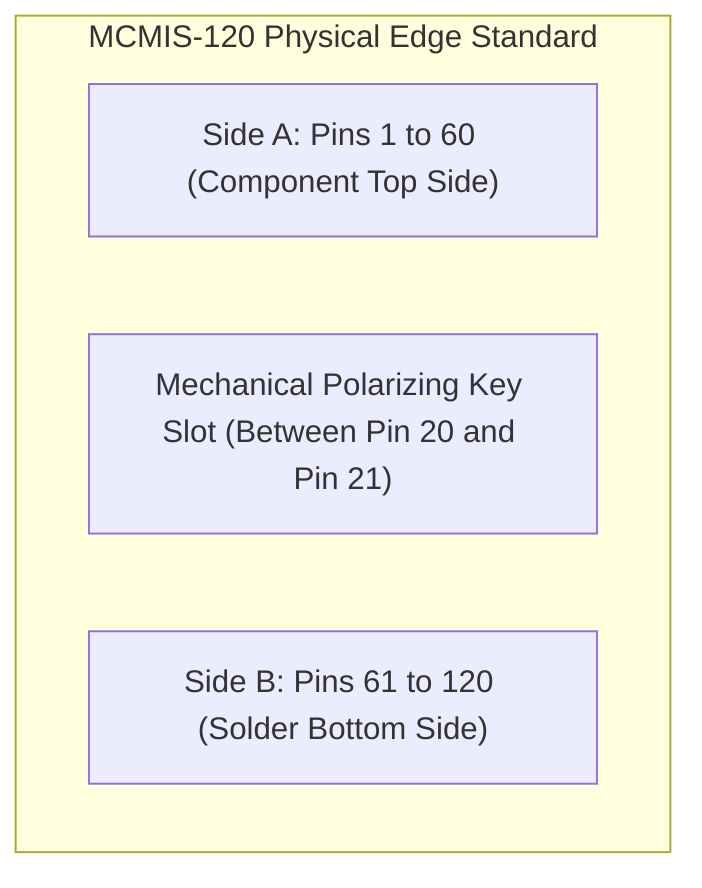

# Mendex Common Module Interface Standard (MCMIS) v1.0

**Standard Document ID:** MPECL-STD-MCMIS-100  
**Revision:** v1.0-RELEASE-CANDIDATE  
**Status:** APPROVED FOR DESIGN  
**Scope:** Universal Electrical and Mechanical Interface Specification for MPECL Platforms  
**Target Organization:** Mendex Electronics LLP  

---

## 1. Scope & Objective

The **Mendex Common Module Interface Standard (MCMIS) v1.0** establishes the definitive electrical, mechanical, logical, and thermal interface rules governing all interchangeable daughtercards and reusable subcircuits developed under the Mendex Power Electronics Core Library (MPECL).

The standard strictly differentiates between:
1. **Logical Interface Compatibility:** Standardized signal naming, voltage thresholds, and communication register maps.
2. **Physical Interchangeability:** Connector pin allocations, mating geometries, and mechanical retention for plug-in daughtercards (e.g., MDC-100, MCM-100, MAP-100).
3. **Layout Subcircuit Rules:** Unbroken copper routing rules, Kelvin connections, and isolation moats for non-connectorized design IP blocks (e.g., MGD-100, MPS-xxx, MSM-100).

---

## 2. Connector Selection & Mechanical Standard

Plug-in controller daughtercards conforming to MCMIS-120 utilize a standardized **120-Pin 0.8 mm Pitch Dual-Row Edge Connector** (or high-density mezzanine connector):

* **Mating Connector Specification:** Standard 120-pin Card Edge Socket (0.8 mm pitch, $30\,\mu\text{in}$ hard gold plating over nickel).
* **Card Thickness:** $1.60\text{ mm} \pm 0.10\text{ mm}$ (Finished FR4).
* **Insertion Force:** $\le 0.6\text{ N}$ per contact pair.
* **Durability:** Rated for $\ge 500$ mating cycles minimum.
* **Mechanical Standoffs:** Dual M2.5 nylon or nickel-plated brass standoffs at corners with captive screws to guarantee retention under $20\text{ G}$ vibration (IEC 60068-2-6).



---

## 3. Standardized 120-Pin Pinout Mapping (MCMIS-120)

To prevent crosstalk and capacitive displacement noise from high-speed switching circuits, **every high-speed PWM signal and analog sense input is flanked by ground shield pins**:

| Pin Range | Primary Signal Function | Signal Class | Ground Shielding & Routing Constraint |
|---|---|---|---|
| **1 – 4** | Auxiliary Logic Power (`+5V_IN`) | Class E | Parallel 4-pin bus; rated for $2.0\text{ A}$ total continuous current |
| **5 – 8** | Digital Ground (`DGND`) | Return | Solid digital ground reference |
| **9 – 12** | Clean Auxiliary Analog Power (`+3.3V_ANA`) | Class E | Filtered low-noise LDO rail for internal ADC references |
| **13 – 16** | Analog Ground (`AGND`) | Return | Dedicated quiet analog ground; star-tied to DGND at single point |
| **17 – 20** | Hardware Reset & System ID (`/RST`, `HW_ID0-2`)| Class D | Resistor strapping pins for automatic module detection |
| **KEY** | **MECHANICAL POLARIZING KEY SLOT** | - | **Prevents reversed insertion into motherboard** |
| **21 – 32** | Complementary High-Speed PWM (`PWM1H/L` to `PWM6H/L`)| Class A | 3.3V LVCMOS; $22\,\Omega$ series damping; matched trace length $\pm 0.5\text{ mm}$ |
| **33 – 40** | Interleaved Digital Grounds (`DGND`) | Return | Interleaved between each PWM pair to suppress cross-coupling |
| **41 – 44** | Fast Hardware Trip Lines (`/TRIP_ZONE1-2`, `/DIS`) | Class C | Active-low open-drain; hardware comparator latch interlock |
| **45 – 60** | Differential Analog Voltage Feedback (`V_IN±`, `V_OUT±`)| Class B | $0 - 3.0\text{ V}$; tightly coupled differential pairs; flanked by AGND |
| **61 – 76** | Differential Analog Current Feedback (`I_IN±`, `I_OUT±`)| Class B | $0 - 3.0\text{ V}$; high-bandwidth current shunt feedback |
| **77 – 84** | Temperature Sensing Channels (`TEMP_CH1-4`) | Class B | Filtered NTC thermistor inputs |
| **85 – 92** | High-Speed Master SPI (`CLK`, `MOSI`, `MISO`, `CS1-3`)| Class D | $40\text{ MHz}$ isolated expansion bus |
| **93 – 98** | System I2C & Internal UART (`SDA`, `SCL`, `TX`, `RX`)| Class D | Parameter communication with MCM-100 and MHM-100 |
| **99 – 104**| CAN-FD Controller Interface (`CAN_TX`, `CAN_RX`) | Class D | Direct lines to isolated transceiver on MCM-100 |
| **105 – 112**| General Purpose I/O & Status LED Drivers | Class D | Relays, pre-charge contactor drivers, status flags |
| **113 – 120**| Power Ground Returns & JTAG/SWD Debug Port | Multi | In-system debugging and firmware flashing lines |

---

## 4. Electrical Signal Integrity & Impedance Rules

1. **High-Speed PWM Lines (Class A):**
   - Characteristic impedance: $Z_0 = 50\,\Omega \pm 10\%$.
   - Series damping resistor ($R_{series} = 22\,\Omega - 33\,\Omega$) placed directly at the MCU output pin.
   - Maximum trace length: $\le 100\text{ mm}$ from connector to gate driver input.
2. **Analog Differential Pairs (Class B):**
   - Differential impedance: $Z_{diff} = 100\,\Omega \pm 10\%$.
   - Parallel trace spacing: $\le 0.2\text{ mm}$; trace length matching: $\pm 0.25\text{ mm}$.
   - No high-voltage or high $dv/dt$ copper planes permitted on adjacent layers directly above or beneath Class B traces.
3. **Safety Trip Lines (Class C):**
   - Active-low open-drain signals pulled up to $+3.3\text{ V}$ via a $2.2\text{ k}\Omega$ metal-film resistor located on the MDC-100 card.
   - Low-pass noise filter cap: $C \le 47\text{ pF}$ to maintain propagation delay $< 20\text{ ns}$.

---

## 5. Galvanic Isolation Boundaries

MCMIS v1.0 enforces four strictly demarcated electrical isolation zones:

```mermaid
graph LR
    ZONE_1["Zone 1: SELV Controller Domain<br/>(MDC-100, MHM-100, Comms Logic)"]
    ZONE_2["Zone 2: Primary Power Domain<br/>(400V DC Link, Grid Line, PFC)"]
    ZONE_3["Zone 3: Secondary Power Domain<br/>(Isolated 48V Bus, Output Shunts)"]
    ZONE_4["Zone 4: Chassis Protective Earth<br/>(PE Metal Enclosure)"]

    ZONE_1 -.->|Reinforced Isolation (4 kVrms)| ZONE_2
    ZONE_2 -.->|Reinforced Isolation (4 kVrms)| ZONE_3
    ZONE_3 ---|Functional Ground / Net Tie| ZONE_1
    ZONE_1 -.->|500V DC Isolation Test| ZONE_4
    ZONE_2 -.->|Reinforced Insulation (Basic + PE)| ZONE_4
```

* **Physical Creepage Slot Rule:** Whenever reinforced isolation is required between Zone 1 and Zone 2, an unplated **isolation slot of minimum $1.5\text{ mm}$ width** must be routed through the PCB laminate under all optocouplers, digital isolators, and pulse transformers to prevent surface tracking along dusty FR4.
