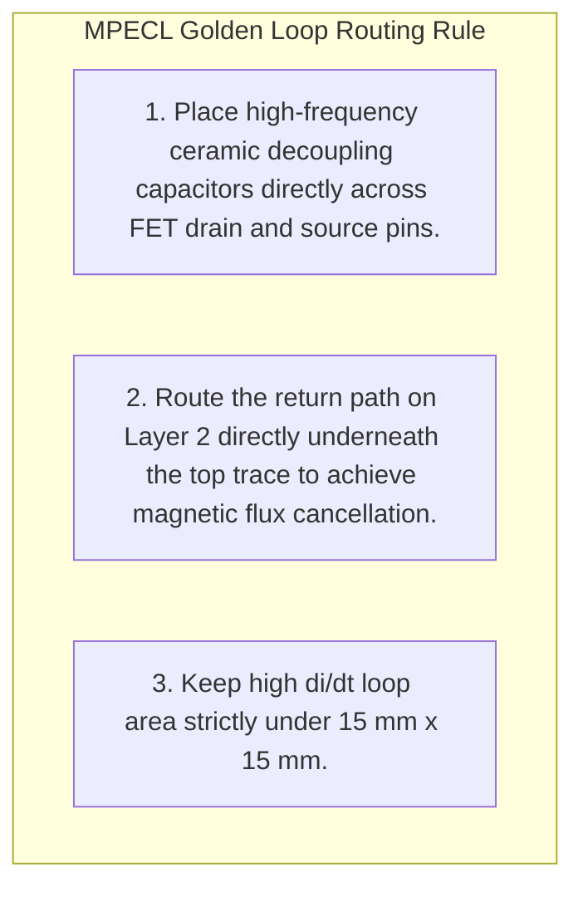

# MPECL Hardware Design & PCB Layout Rules

**Standard Document ID:** MPECL-STD-DR-001  
**Revision:** v1.0  
**Status:** APPROVED FOR DESIGN  
**Target Organization:** Mendex Electronics LLP  

---

## 1. PCB Layer Stackup Standards for Power Electronics

To balance fabrication costs in India with electromagnetic compatibility (EMC) and thermal performance, MPECL standardizes two PCB stackups:

### Stackup 1: 4-Layer Standard Power Board (Tier 1: 100 W – 1 kW)
* **Layer 1 (Top Copper, 2 oz / 70 µm):** Power components, gate drives, high-current switching traces.
* **Layer 2 (Inner 1, 1 oz / 35 µm):** Solid, unbroken Ground Plane (PGND / DGND). **Zero signal routing permitted on Layer 2.**
* **Layer 3 (Inner 2, 1 oz / 35 µm):** Power distribution rails ($+12\text{V}, +5\text{V}$) and shielded analog sense lines.
* **Layer 4 (Bottom Copper, 2 oz / 70 µm):** Secondary power copper pours, auxiliary circuits, thermal dissipation pads.

### Stackup 2: 6-Layer Heavy-Copper High-Power Board (Tiers 2 & 3: 1 kW – 15 kW)
* **Layer 1 (Top, 3 oz / 105 µm):** High-voltage busbars, primary inverter bridges, planar transformer terminals.
* **Layer 2 (Inner 1, 2 oz / 70 µm):** Continuous primary power ground (PGND1).
* **Layer 3 (Inner 2, 1 oz / 35 µm):** Shielded control and gate drive differential signals.
* **Layer 4 (Inner 3, 1 oz / 35 µm):** Auxiliary DC-DC power routing and status flags.
* **Layer 5 (Inner 4, 2 oz / 70 µm):** Continuous secondary power ground (PGND2).
* **Layer 6 (Bottom, 3 oz / 105 µm):** Secondary high-current synchronous rectification planes.

---

## 2. High-Frequency Switching Loop Rules

In high-speed power conversion, parasitic inductance ($L_{stray}$) is the primary source of voltage spikes, ringing, and radiated emissions:

$$V_{spike} = L_{stray} \cdot \frac{di}{dt}$$

For a Silicon Carbide switch transitioning $30\text{ A}$ in $15\text{ ns}$ ($\frac{di}{dt} = 2\text{ A/ns}$), just **$10\text{ nH}$ of loop inductance produces a destructive $20\text{ V}$ overshoot spike** above the DC bus.

---

## 3. Kelvin Connections for Gate and Shunt Terminals

1. **Gate Drive Kelvin Source Connection:**
   - Power MOSFETs in TO-247-4L packages or SMD packages have two source pins: Power Source and Kelvin Driver Source.
   - **Mandatory Rule:** The gate driver ground return trace must connect exclusively to the **Kelvin Source pin**. It must never share copper with the high-current power source trace carrying inductor switching currents. Failure to follow this rule injects $L_{source} \cdot \frac{di}{dt}$ voltage directly into the gate loop, causing gate bounce and shoot-through.
2. **Current Shunt 4-Terminal Kelvin Connection:**
   - Shunt sensing traces must tap the inner voltage pads of the shunt resistor and route as a tightly coupled differential pair into the differential amplifier.

---

## 4. Clearance, Creepage & Thermal Relief Rules

1. **Creepage Calculation Standard:** Conforms strictly to IEC 60664-1 for Pollution Degree 2, Material Group IIIa:
   - For $400\text{ V DC}$ link: Minimum clearance $= 3.0\text{ mm}$, minimum creepage $= 6.3\text{ mm}$.
   - For $800\text{ V DC}$ link: Minimum clearance $= 5.5\text{ mm}$, minimum creepage $= 8.0\text{ mm}$.
2. **Thermal Vias for SMD Power Devices:**
   - High-power SMD packages (D2PAK, PDFN56) must incorporate an array of thermal vias directly beneath the exposed metal thermal pad.
   - Via diameter: $0.3\text{ mm}$ (to prevent solder wicking into vias during reflow).
   - Via pitch: $1.0\text{ mm} - 1.2\text{ mm}$ in a staggered grid.
   - Vias must connect the top thermal pad directly to inner and bottom copper ground planes for heat spreading.
