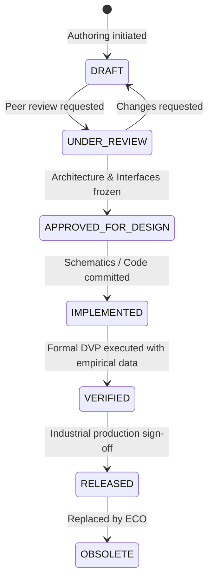

# MPECL Document Naming, Identification & Lifecycle Control

**Standard Document ID:** MPECL-STD-DOC-001  
**Revision:** v1.0  
**Status:** APPROVED FOR DESIGN  
**Target Organization:** Mendex Electronics LLP  

---

## 1. Document & Hardware Identifier Taxonomy

To maintain traceability across product lifecycles, all documents, schematics, PCB assemblies, and firmware source repositories in MPECL follow a strict standardized nomenclature:

$$\text{MPECL}-\langle\text{TYPE}\rangle-\langle\text{MODULE/SYSTEM}\rangle-\langle\text{SEQ}\rangle$$

### 1.1 Type Identifiers
* `STD`: Engineering Standard or Guideline
* `DOC`: General Architecture or System Document
* `MOD`: Module Technical Specification
* `SCH`: KiCad Schematic Design
* `PCB`: KiCad Board Layout Design
* `FW`: Firmware Source Package
* `DVP`: Design Verification Plan
* `DVR`: Design Verification Report
* `FMEA`: Failure Mode and Effects Analysis
* `BOM`: Bill of Materials

### 1.2 Module Numbering Convention
* `MDC-1xx`: Universal Digital Controllers
* `MGD-1xx`: Gate Driver IP Blocks
* `MSM-1xx`: Sensing IP Blocks
* `MSP-1xx`: Smart Protection IP Blocks
* `MAP-1xx`: Auxiliary Power Supplies
* `MCM-1xx`: Connectivity & Fieldbus Modules
* `MHM-1xx`: Human Machine Interface Panels
* `MTM-1xx`: Thermal Monitoring & Fan Drivers
* `MPS-1xx`: Buck Converter Power Stages
* `MPS-2xx`: Boost Converter Power Stages
* `MPS-3xx`: Isolated & Resonant Power Stages
* `MEM-1xx`: EMI/EMC Filter IP Blocks
* `MPC-1xx`: Parallel & Current Sharing Modules
* `MVT-1xx`: Validation & Test Harnesses

---

## 2. Six-Stage Engineering Lifecycle Status Workflow

Every document, specification, and hardware design file in MPECL must declare its status according to the 6-stage lifecycle model:

1. **DRAFT:** Work in progress; subject to substantial changes.
2. **UNDER REVIEW:** Submitted for architectural and peer review; baseline under lock.
3. **APPROVED FOR DESIGN:** Technical requirements, pinouts, and interfaces locked. Hardware schematic or firmware coding authorized to commence.
4. **IMPLEMENTED:** Schematics, layouts, or firmware source committed to repository with clean build.
5. **VERIFIED:** Validated against formal Design Verification Plan (DVP) with traceable physical test data or vetted simulation records.
6. **RELEASED:** Formally released for commercial manufacturing and volume assembly.

> [!IMPORTANT]
> A module or document **must never skip directly from IMPLEMENTED to RELEASED**. Passing through the `VERIFIED` stage requires attaching authentic test evidence (oscilloscope waveforms, efficiency logs, thermal scans) with cryptographic SHA-256 hashes bound to the record in Mendex Studio.
