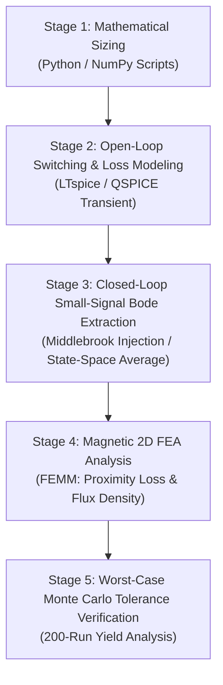

# MPECL Comprehensive Simulation Strategy

**Document ID:** MPECL-DOC-SIM-001  
**Revision:** v1.0  
**Status:** APPROVED FOR DESIGN  
**Target Organization:** Mendex Electronics LLP  

---

## 1. Multi-Stage Simulation Methodology

In MPECL, simulation is not treated as a single monolithic step, but as a phased analytical pipeline designed to de-risk hardware tape-out:

---

## 2. Open-Loop vs. Closed-Loop Simulation Workflows

### 2.1 Open-Loop Time-Domain Verification
* **Purpose:** Determine accurate semiconductor switching losses ($E_{on}, E_{off}$), conduction losses, peak reverse recovery currents ($I_{rr}$), and drain-source voltage overshoot ($V_{DS,pk}$).
* **Method:** Power switches are driven by fixed-duty square wave generators with realistic gate driver output impedances ($R_{drv}$) and parasitic gate trace inductances ($L_{gate}$).
* **Snubber Tuning:** RC snubbers are optimized by observing switch-node ringing frequency ($f_{ring}$) and parasitic capacitance ($C_{oss}$):
  $$C_{snub} \approx 2 \cdot C_{oss}, \quad R_{snub} \approx \sqrt{\frac{L_{stray}}{C_{oss}}}$$

### 2.2 Closed-Loop Small-Signal Bode Analysis
* **Purpose:** Design digital compensators ($G_c(z)$) that provide robust gain and phase margins across the entire line and load envelope.
* **Method:** In LTspice, the switching converter is simulated in closed loop until steady state is reached ($t > 5\text{ ms}$). An AC perturbation source ($V_{inj}$) is injected via the `.step` or `.fourier` directive, or modeled using linearized state-space averaged models (PWM switch model).
* **Target Criteria:**
  - Crossover frequency: $f_c \in \left[\frac{f_{sw}}{10}, \frac{f_{sw}}{5}\right]$
  - Phase Margin: $\ge 50^\circ$
  - Gain Margin: $\ge 12\text{ dB}$

---

## 3. High-Frequency Magnetic Core Loss Modeling

Standard transformer and inductor models in SPICE assume constant inductance and zero core loss. MPECL incorporates the **Generalized Steinmetz Equation (iGSE)** to model magnetic core dissipation under non-sinusoidal excitation:

$$P_{core} = \frac{1}{T} \int_0^T k_i \left|\frac{dB}{dt}\right|^\alpha (\Delta B)^{\beta - \alpha} dt$$

Where:
* $k, \alpha, \beta$ are empirical core loss coefficients from manufacturer datasheets (e.g., TDK N87 or Ferroxcube 3C95).
* $\Delta B$ is the peak-to-peak magnetic flux density swing:
  $$\Delta B = \frac{V \cdot D}{N \cdot A_e \cdot f_{sw}}$$
* **Finite Element Analysis (FEMM):** Transformer winding window geometry is simulated in open-source **FEMM 4.2** to quantify AC resistance factor ($F_R = R_{ac} / R_{dc}$) caused by 2D proximity effect and fringing flux around core air gaps.

---

## 4. Simulation Artifact Archiving in Mendex Studio

Every simulation deck executed during an MPECL module development cycle must be committed to the module package in Mendex Studio:
- Schematic netlist: `.asc` (LTspice) or `.cir` (SPICE netlist).
- Raw simulation log: `.log` containing Fourier coefficients, operating point data, and step runtimes.
- Digest hash: SHA-256 hash computed and bound to the engineering record.
- **Classification:** Results are permanently recorded as `SIMULATION_VERIFIED`, remaining strictly differentiated from physical bench testing evidence (`PHYSICAL_VERIFIED`).
