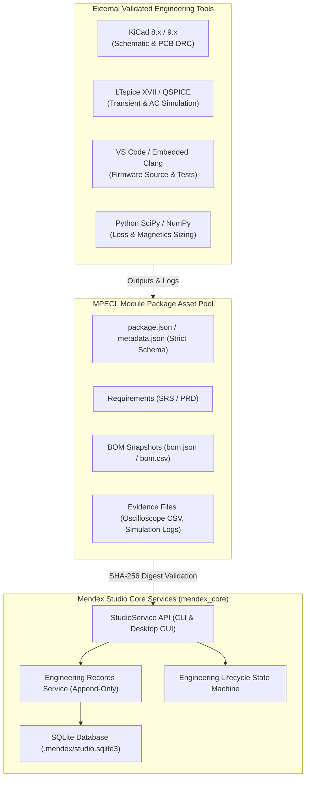

# MPECL Integration with Mendex Studio

**Document ID:** MPECL-DOC-INT-001  
**Revision:** v1.0  
**Status:** APPROVED FOR DESIGN  
**Target Organization:** Mendex Electronics LLP  

---

## 1. Architectural Role of Mendex Studio

**Mendex Studio** operates as an engineering orchestration, data provenance, and validation tracking platform. It is not an integrated circuit simulator or PCB CAD software; rather, it coordinates external validated engineering tools (VS Code, LTspice, KiCad, Python solvers) and maintains an immutable, append-only engineering database (`.mendex/studio.sqlite3`).

The **Mendex Power Electronics Core Library (MPECL)** integrates seamlessly into Mendex Studio by representing every module as a **Standardized Engineering Package**.



---

## 2. Mendex Studio Module Package Structure

Every reusable module in MPECL is organized on disk as an encapsulated package:

```text
07-module-specifications/MDC-100/
├── package.json              # Structured metadata, version, dependencies, interfaces
├── spec.md                   # 20-Section engineering specification
├── requirements/
│   ├── prd.json              # Product requirements with unique IDs
│   └── srs.json              # System engineering specifications
├── design/
│   ├── kicad/                # Hierarchical schematic sheets & symbols (.kicad_sch)
│   └── spice/                # Vetted simulation models (.asc, .sub)
├── firmware/                 # Target HAL drivers and header interfaces (.c, .h)
├── validation/
│   ├── dvp.json              # Design verification plan matrix
│   └── evidence/             # SHA-256 indexed bench test logs and waveforms
└── approvals/
    └── signoffs.json         # Formal reviewer signoffs and ECO records
```

---

## 3. Package Discovery & Compatibility Verification

Mendex Studio discovers available modules by scanning the library directories and parsing `package.json` manifests.

When an engineer initiates a new converter design (e.g., *1 kW Phase-Shifted Full-Bridge Charger*):
1. **Module Compatibility Check:** Mendex Studio compares the converter specification ($V_{in}, V_{out}, P_{out}$) against the module's operating envelope defined in `package.json`.
2. **Interface Pinout Validation:** Studio verifies that the selected controller card (MDC-100) satisfies all required PWM channels, analog ADC inputs, and trip lines.
3. **Evidence Integrity Verification:** Mendex Studio recalculates the SHA-256 checksum of all linked simulation logs and test reports. If an artifact was modified outside of Studio, its validation status instantly reverts to `NOT_EVALUATED` in compliance with `docs/engineering-rules.md`.

---

## 4. Automated Engineering Report Generation

Mendex Studio extracts data directly from the module packages to generate formal engineering dossiers:
- **Design Verification Report (DVR):** Synthesizes test results against SRS requirements, showing measured vs. simulated values.
- **Master Bill of Materials (BOM):** Aggregates part numbers, manufacturer codes, and Indian distributor availability notes.
- **Traceability Matrix:** Proves $100\%$ verification coverage for all safety-critical parameters.
