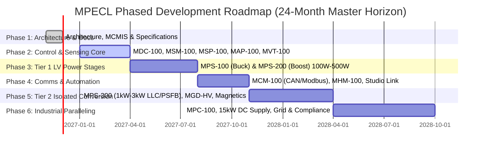

# MPECL Phased Engineering Roadmap

**Document ID:** MPECL-DOC-RDM-001  
**Revision:** v1.0  
**Status:** APPROVED FOR DESIGN  
**Target Organization:** Mendex Electronics LLP  

---

## 1. Executive Roadmap Overview

Developing an industrial power electronics platform spanning $100\text{ W}$ to $15\text{ kW}$ requires a disciplined, risk-mitigated phased progression. Attempting to build high-voltage multi-kilowatt converters before thoroughly verifying the digital control core, gate drive loops, and autonomous protection circuits on low-voltage hardware is a catastrophic engineering anti-pattern.

---

## 2. Phase-by-Phase Execution Details

### Phase 1: Architecture, Interfaces & Standards (Current Phase)
* **Duration:** Months 1 – 2 (Nov 2026 – Dec 2026)
* **Objectives:** Define the complete architectural blueprint, pinout standards (MCMIS v1.0), 14 module specifications, simulation workbenches, and Mendex Studio metadata contracts.
* **Deliverables:** Complete MPECL v1.0 documentation repository, JSON schemas, and Engineering Readiness Report.
* **Dependencies:** None.
* **Required Skills:** Principal Power Electronics Architect, Embedded Systems Architect, Systems Safety Lead.
* **Laboratory Requirements:** Standard engineering CAD workstations with KiCad, LTspice, and VS Code.
* **Budget Assumption:** Minimal internal engineering NRE ($< \$5,000\text{ USD}$).
* **Go/No-Go Gate:** Formal sign-off on MCMIS-120 pinout and hybrid modularity model.

---

### Phase 2: Common Control, Sensing & Protection Core
* **Duration:** Months 3 – 6 (Jan 2027 – Apr 2027)
* **Objectives:** Build, bring up, and thoroughly validate the low-voltage control and protection backbone before building high-power stages.
* **Deliverables:**
  1. MDC-100-ST (STM32G474) and MDC-100-TI (TMS320F280039C) prototype daughtercards.
  2. MVT-100 automated breakout and test fixture.
  3. MSP-100 hardware protection circuit with verified $< 750\text{ ns}$ trip latency.
  4. MAP-100-LV auxiliary power supply ($18\text{ V} - 75\text{ V} \to 12\text{V}, 5\text{V}, 3.3\text{V}$).
  5. MCC base firmware repository (HAL, state machine, 2P2Z compensators, trip zone ISRs).
* **Dependencies:** Phase 1 sign-off.
* **Required Skills:** Mixed-signal PCB layout engineer, embedded firmware engineer.
* **Laboratory Requirements:** 500 MHz 4-channel oscilloscope, low-noise DC bench supply, programmable signal generator, logic analyzer.
* **Estimated Cost:** **~\$6,500 USD** (PCB fabrication in India, component samples, Samtec sockets, fixture assembly).
* **Go/No-Go Gate:** 
  - Sub-50 ns trip zone hardware latency verified on bench.
  - Multi-target HAL verified executing 2P2Z difference equation in $\le 2.5\,\mu\text{s}$.

---

### Phase 3: Initial Low-Voltage Power Stages (Tier 1 Priority: 100 W – 500 W)
* **Duration:** Months 6 – 10 (Apr 2027 – Aug 2027)
* **Objectives:** Validate end-to-end closed-loop power conversion on non-isolated low-voltage platforms ($48\text{ V}$ to $12\text{ V} / 24\text{ V}$ Synchronous Buck MPS-100 and Boost MPS-200).
* **Deliverables:**
  1. MPS-100 500W Synchronous Buck Motherboard with integrated MGD-100-LV and MSM-100.
  2. MPS-200 500W Boost Converter Motherboard for solar MPPT.
  3. Verified closed-loop regulation, dynamic step response, and efficiency contour map.
  4. 72-hour full-load thermal soak report under $50^\circ\text{C}$ ambient conditions.
* **Dependencies:** Phase 2 control daughtercards and test harnesses.
* **Required Skills:** Power hardware engineer, magnetics winding technician, thermal engineer.
* **Laboratory Requirements:** 60V / 30A DC power supply, 500W programmable electronic load, thermal imaging camera (FLIR), coaxial ripple probes.
* **Estimated Cost:** **~\$9,000 USD** (Power PCBs, Sendust inductors, high-current FETs, electronic load rental).
* **Go/No-Go Gate:**
  - Full-load efficiency $\ge 96.0\%$ verified.
  - Output ripple $\le 50\text{ mV}_{pk-pk}$ with zero limit cycling.
  - 50 consecutive dead short-circuit applications survived without semiconductor failure.

---

### Phase 4: Communication, Automation & Studio Telemetry
* **Duration:** Months 10 – 13 (Aug 2027 – Nov 2027)
* **Objectives:** Expand Tier 1 converters with industrial communications, front-panel HMI, and automated Mendex Studio integration.
* **Deliverables:**
  1. MCM-100 Isolated CAN-FD and RS485 / Modbus RTU daughtercard.
  2. MHM-100 front-panel OLED / rotary encoder assembly.
  3. Standardized SCPI parser over USB-CDC.
  4. Mendex Studio automated DVP test script suite.
* **Dependencies:** Phase 3 operational converters.
* **Required Skills:** Embedded software engineer, desktop integration developer.
* **Laboratory Requirements:** CAN bus protocol analyzer, Modbus PLC test rig.
* **Estimated Cost:** **~\$5,000 USD** (Transceiver prototyping, front bezels, display samples).
* **Go/No-Go Gate:**
  - Automated 24-step DVP executed directly from Mendex Studio over SCPI with zero human intervention.

---

### Phase 5: High-Voltage Isolated Conversion (Tier 2: 1 kW – 3 kW)
* **Duration:** Months 13 – 18 (Nov 2027 – Apr 2028)
* **Objectives:** Design, build, and validate high-voltage galvanically isolated conversion (400 V DC link to 48 V DC output).
* **Deliverables:**
  1. MPS-300-LLC Resonant and PSFB 3 kW Power Stage.
  2. MGD-100-HV Isolated SiC Gate Driver IP with $+18\text{ V} / -4\text{ V}$ bias and DESAT protection.
  3. Custom high-frequency planar transformer ($4\text{ kV}_{RMS}$ reinforced isolation).
  4. MAP-100-HV 85V–450V isolated auxiliary flyback supply.
  5. Pre-compliance conducted emissions report conforming to CISPR 32 Class A.
* **Dependencies:** Phases 2, 3, and 4 complete and verified.
* **Required Skills:** High-voltage safety engineer, high-frequency planar magnetics specialist, SiC power engineer.
* **Laboratory Requirements:** High-voltage safety test enclosure, 600V DC source, 3kW regenerative DC load, 4kV dielectric hipot tester, LISN + Spectrum Analyzer.
* **Estimated Cost:** **~\$22,000 USD** (High-voltage test bench equipment, planar transformer tooling, SiC MOSFETs, EMC pre-scan chamber time).
* **Go/No-Go Gate:**
  - Dielectric withstand $4.0\text{ kV}_{RMS}$ verified for 60 seconds.
  - Zero-Voltage Switching (ZVS) confirmed on primary bridge from $20\%$ to $100\%$ load.
  - Peak efficiency $\ge 97.0\%$ at rated 3 kW power.

---

### Phase 6: Industrial Expansion, Paralleling & Multi-Kilowatt Platform (Tier 3: 5 kW – 15 kW)
* **Duration:** Months 18 – 24 (Apr 2028 – Oct 2028)
* **Objectives:** Integrate multi-module current sharing (MPC-100), active interleaving, and industrial 3-phase grid interfaces to deliver a commercial 15 kW Programmable DC Power Supply.
* **Deliverables:**
  1. MPC-100 Active Current Share and Synchronization Module.
  2. 19-inch 3U rackmount modular power chassis accepting up to 5x 3 kW modules.
  3. Complete commercial manufacturing package (BOM, Gerbers, work instructions).
  4. Full accredited laboratory certification reports (IEC 62368-1, IEC 61000-4-x, CE mark).
* **Dependencies:** Phase 5 verified 3 kW modules.
* **Required Skills:** Industrial mechanical packaging engineer, compliance certification lead.
* **Laboratory Requirements:** 3-phase 415V / 32A mains supply, 15kW resistive/electronic load bank.
* **Estimated Cost:** **~\$35,000 USD** (Sheet metal tooling, busbars, NABL accredited laboratory test fees).
* **Go/No-Go Gate:**
  - 15 kW continuous burn-in verified for 100 hours at $45^\circ\text{C}$ ambient.
  - Current sharing balance verified $\le \pm 2.0\%$ across all 5 paralleled modules.
  - Accredited third-party compliance certificates bound in Mendex Studio.
