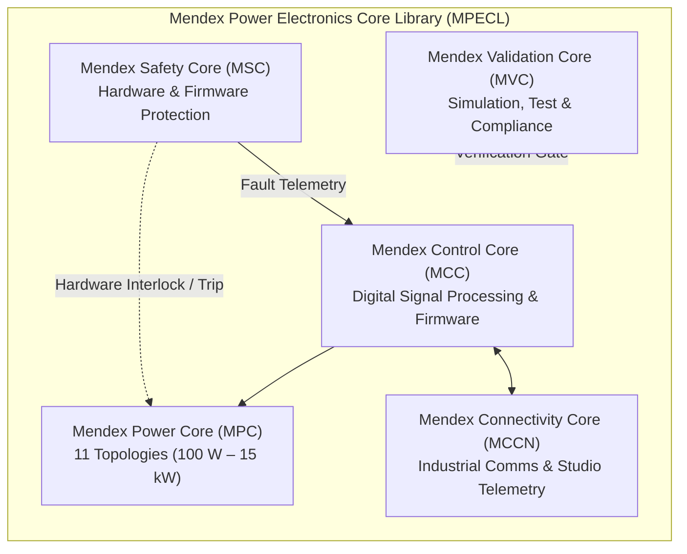

# Mendex Power Electronics Core Library (MPECL) v1.0

**Document ID:** MPECL-DOC-ROOT-001  
**Revision:** v1.0-DRAFT  
**Status:** UNDER REVIEW  
**Organization:** Mendex Electronics LLP, India  
**Lead Architect:** Principal Power Electronics Architect & Embedded Lead  

---

## 1. Executive Summary

The **Mendex Power Electronics Core Library (MPECL)** is a standardized, modular engineering library developed by Mendex Electronics LLP to accelerate the research, design, verification, and manufacturing of industrial power conversion systems. 

Historically, developing power converters across disparate applications—such as solar inverters, battery energy storage chargers, electric vehicle (EV) DC-DC converters, programmable laboratory power supplies, and industrial power units—required redesigning control electronics, gate drivers, protection circuits, auxiliary power supplies, and firmware from scratch. This resulted in high engineering NRE (non-recurring engineering) overhead, inconsistent reliability, fragmented firmware codebases, and prolonged time-to-market.

MPECL addresses this challenge through a **Hybrid Modularity Model**:
1. **Physical Standardized Daughtercards:** Digital control (MDC-100), isolated communications (MCM-100), HMI (MHM-100), and auxiliary power (MAP-100).
2. **Validated Reusable Design IP Blocks (Hierarchical KiCad Subcircuits):** Gate driver circuits (MGD-100), precision sensing (MSM-100), smart hardware protection (MSP-100), power stages (MPS-100/200/300), and EMI filters (MEM-100).
3. **Unified Firmware & Control Core (MCC):** Common state machines, discrete compensators (2P2Z/3P3Z), multi-tiered fault handlers, and fieldbus protocol stacks.
4. **Mendex Studio Integration:** Machine-readable engineering packages with traceable simulation models, BOMs, and verification evidence under strict provenance tracking.



---

## 2. Directory Structure

```text
mendex-power-electronics-library/
│
├── README.md                           # Master library overview and index
├── 00-project-overview/                # Vision, business objectives, engineering scope
│   ├── vision.md
│   ├── objectives.md
│   └── scope.md
│
├── 01-system-architecture/             # Top-level platform design, hybrid modularity, reusability matrix
│   ├── architecture.md
│   ├── platform-design.md
│   ├── module-interfaces.md
│   └── reusability-matrix.md
│
├── 02-control-core/                    # Digital controller architecture, DSP/MCU selection, control loops
│   ├── overview.md
│   ├── controller-selection.md
│   ├── digital-control-loops.md
│   └── firmware-architecture.md
│
├── 03-power-core/                      # 11 Power topologies, magnetics, semiconductor selection, thermal
│   ├── overview.md
│   ├── topologies-non-isolated.md
│   ├── topologies-isolated-basic.md
│   └── topologies-advanced-resonant.md
│
├── 04-safety-core/                     # Sensing, hardware trips, fault latching, insulation & safety standards
│   ├── overview.md
│   ├── sensing-architecture.md
│   ├── protection-circuits.md
│   └── standards-and-compliance.md
│
├── 05-connectivity-core/               # Fieldbuses (CAN-FD, Modbus/RS485), SCPI, HMI, Studio telemetry
│   ├── overview.md
│   ├── protocols.md
│   ├── hmi-interface.md
│   └── mendex-studio-link.md
│
├── 06-validation-core/                 # LTspice simulation, DVP execution, derating, thermal & EMC verification
│   ├── overview.md
│   ├── simulation-standards.md
│   ├── verification-procedures.md
│   └── derating-and-thermal.md
│
├── 07-module-specifications/           # 14 Detailed module engineering specifications (20-section format)
│   ├── MDC-100/                        # Universal Digital Controller Card
│   ├── MGD-100/                        # MOSFET/SiC Gate Driver Circuit IP
│   ├── MSM-100/                        # Voltage and Current Sensing Circuit IP
│   ├── MSP-100/                        # Smart Protection & Hardware Latch IP
│   ├── MAP-100/                        # Auxiliary Power Supply Module
│   ├── MCM-100/                        # Communication Interface Card
│   ├── MHM-100/                        # Human Machine Interface Panel
│   ├── MTM-100/                        # Thermal Monitoring & Fan Controller
│   ├── MPS-100/                        # Synchronous Buck Power Stage IP
│   ├── MPS-200/                        # Boost Power Stage IP
│   ├── MPS-300/                        # Isolated Power Stage IP (LLC / PSFB)
│   ├── MEM-100/                        # EMI/EMC Filter IP
│   ├── MPC-100/                        # Parallel Control & Current Sharing Module
│   └── MVT-100/                        # Validation, Breakout & Automated Test Fixture
│
├── 08-engineering-standards/           # Interface standards (MCMIS v1.0), design rules, SI units
│   ├── MCMIS-v1.0.md
│   ├── design-rules.md
│   └── naming-and-numbering.md
│
├── 09-simulation-strategy/             # Simulation workflows, worst-case Monte Carlo, models
│   └── strategy.md
│
├── 10-mendex-studio-integration/       # Studio JSON/YAML schemas, artifact contracts, tool invocation
│   ├── integration-architecture.md
│   └── module-package-schema.json
│
├── 11-development-roadmap/             # Phased roadmap (Phases 1–6), resource plans, Go/No-Go gates
│   └── phased-roadmap.md
│
├── 12-risk-and-compliance/             # DFMEA, safety barrier analysis, Indian grid resilience
│   ├── dfmea.md
│   └── compliance-matrix.md
│
├── 13-research-and-references/         # Evaluated reference designs, literature, component sourcing in India
│   └── research-evaluation.md
│
├── 14-document-templates/              # Standardized engineering templates (PRD, SRS, HDS, FDS, ICD, etc.)
│   ├── PRD-template.md
│   ├── SRS-template.md
│   ├── HDS-template.md
│   ├── FDS-template.md
│   ├── ICD-template.md
│   ├── DFMEA-template.md
│   ├── DVP-template.md
│   ├── DVR-template.md
│   ├── BOM-template.md
│   ├── ECR-ECO-template.md
│   └── Release-Checklist.md
│
└── 15-engineering-readiness/           # Formal readiness assessment, RTM, Gap Register
    └── readiness-report-v1.0.md
```

---

## 3. Engineering Lifecycle Status Model

In compliance with Mendex Electronics engineering governance, all documentation, specifications, and hardware/firmware artifacts adhere to the immutable 6-stage lifecycle model:

$$\text{DRAFT} \longrightarrow \text{UNDER REVIEW} \longrightarrow \text{APPROVED FOR DESIGN} \longrightarrow \text{IMPLEMENTED} \longrightarrow \text{VERIFIED} \longrightarrow \text{RELEASED}$$

* **DRAFT:** Initial engineering proposal, active authoring.
* **UNDER REVIEW:** Submitted for formal peer and architectural review.
* **APPROVED FOR DESIGN:** Architecture, calculations, and interfaces locked for schematic/firmware design.
* **IMPLEMENTED:** Schematics, layouts, or firmware code committed.
* **VERIFIED:** Validated against formal Design Verification Plan (DVP) with traceable physical test evidence or vetted simulation logs.
* **RELEASED:** Formally released for industrial production.

> [!IMPORTANT]
> In accordance with Mendex engineering rules, **no module or design is marked VERIFIED without traceable simulation records or physical prototype measurement evidence**. All uncalculated or pending empirical ratings are explicitly marked `TBD` with the specified engineering determination procedure.
